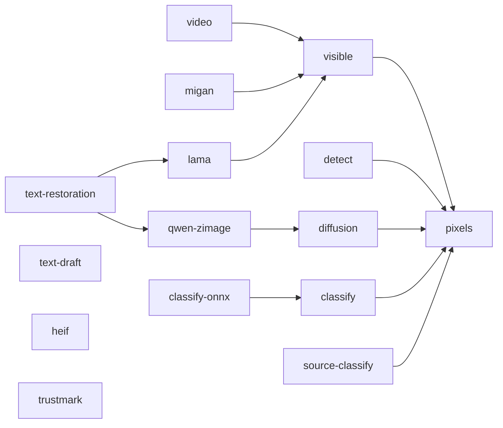

# Installation

Python 3.11 through 3.14 are supported.

## Default metadata mode

The default package provides:

- provenance inspection;
- AI metadata inspection and removal.

It installs Pillow, piexif, and c2pa-python for reading metadata directly from
files. It does not install NumPy, OpenCV, pillow-heif, Torch, diffusion models,
or invisible-watermark decoders.

Install it as an isolated command with uv:

```bash
uv tool install remove-ai-watermarks
```

Or with pipx:

```bash
pipx install remove-ai-watermarks
```

You can also install the Homebrew package on macOS or Linux:

```bash
brew install wiltodelta/tap/remove-ai-watermarks
```

Homebrew installs the `visible` extra by default. Each extra published with the
pinned package has a matching `--with-<extra>` option, and options can be combined:

```bash
# Seedance and SynthID video processing
brew install wiltodelta/tap/remove-ai-watermarks --with-video --with-diffusion

# The package's all group
brew install wiltodelta/tap/remove-ai-watermarks --with-all

# Base metadata/provenance tools, without the default pixel dependencies
brew install wiltodelta/tap/remove-ai-watermarks --without-default-extras

# Base plus HEIF support only
brew install wiltodelta/tap/remove-ai-watermarks --without-default-extras --with-heif

# List the options for the currently pinned release
brew options wiltodelta/tap/remove-ai-watermarks
```

To add features to an existing installation, use `brew reinstall` with the desired
options. Homebrew retains previously selected options on reinstall and upgrade.
To remove old extras or replace the selection exactly, uninstall the formula and
install it again with the complete desired option set. The `all` option uses the
package's own `all` group; other groups remain individually selectable.

The formula creates an isolated Python environment and installs the requested
extras with their dependencies. Python is supplied by Homebrew; the `video` extra
supplies FFmpeg and ffprobe. Models still download on first use, and each backend's
platform, wheel, and hardware requirements still apply. In particular, image
regeneration profiles require NVIDIA CUDA; video VAE processing supports CPU,
MPS, or CUDA with a compatible Torch stack.

Without pixel extras, `identify`, `metadata`, `batch --mode metadata`,
`video metadata`, `video identify --no-visible`, and `video batch --mode metadata`
still provide metadata-only results.

## Visible watermark removal

Visible mark detection, OpenCV inpainting, and manual region erasing need the
`visible` extra:

```bash
uv tool install --force "remove-ai-watermarks[visible]"
```

Add `heif` only when the pixel path must decode HEIC, HEIF, or AVIF:

```bash
uv tool install --force "remove-ai-watermarks[visible,heif]"
```

## Video processing

Video metadata inspection works with the default package, and MP4 and MOV
stripping uses the in-tree ISOBMFF box walker. Stripping the non-ISOBMFF
containers (MKV, WebM, AVI, FLV, and the audio formats) and writing any cleaned
video need FFmpeg. The `video` extra installs both FFmpeg and ffprobe, so no
separate system installation is needed. Stable
visible-mark identification and removal, full video cleaning, and visible/all
batch modes need the `video` extra:

```bash
uv tool install --force "remove-ai-watermarks[video]"
```

The extra includes the visible pixel runtime and PyAV for preserving variable
frame timestamps, plus the offline `portable-ffmpeg-full` binary bundle. A complete
system FFmpeg/ffprobe pair takes precedence; otherwise the library extracts the
installed bundle on first use, without a network download or changing `PATH`.
The verified binaries are extracted into `~/.cache/remove-ai-watermarks/ffmpeg`,
so the installed package directory can be read-only. Separate CLI processes
serialize extraction through a file lock. Metadata-only installations can still
use system FFmpeg or add the `video` extra when needed.

The bundle supports Windows x64 (Windows 10 22H2+), macOS Intel/Apple Silicon
(macOS 12+), and Linux x64/ARM64 (glibc 2.28+, Linux 4.18+). Other platforms need
a system build and a source installation without the `video` extra, with the
pixel and PyAV dependencies installed separately. FFmpeg binaries have their
own GPL and third-party notices; see the
[distribution's licenses and corresponding source](https://github.com/mrkbac/portable-ffmpeg#licenses-and-corresponding-source).

Video SynthID regeneration and the experimental Seedance profile also need the diffusion stack:

```bash
uv tool install --force "remove-ai-watermarks[video,diffusion]"
```

## Invisible watermark removal

Install the `qwen-zimage` extra:

```bash
uv tool install --force "remove-ai-watermarks[qwen-zimage]"
```

The `qwen-zimage`, `qwen21-zimage`, and `sdxl-zimage` profiles run a Z-Image face
stage on the DiffSynth runtime, so they need this extra (`qwen21-zimage` use
`Qwen/Qwen-Image-2.1` under the non-commercial Qwen Research License, for research
and personal use only). `chroma-zimage` uses diffusers'
ChromaImg2ImgPipeline instead of DiffSynth for its global stage but inherits
the same face stage, so it needs this extra too. The extra also installs
SentencePiece for Chroma1-HD's binary `spiece.model`; without that backend,
Transformers cannot construct the Chroma tokenizer. It includes the `diffusion`
dependencies; `diffusion` on its own covers the torch and diffusers imports but
not the face stage or Chroma tokenizer, so it is not enough to run a removal.
The extra also installs LPIPS for the default Qwen-2.1 fidelity stages. Its AlexNet
weights load lazily on CPU and use the Torch cache (`TORCH_HOME`).

**An NVIDIA GPU is required for the diffusion profiles.** `qwen-zimage`,
`qwen21-zimage`, `sdxl-zimage` and `chroma-zimage` are CUDA-only, and
construction refuses any other device rather than falling back to a slow or broken
one. There is no CPU, MPS or XPU path for those profiles. The specialized API for
the validated local Microsoft Paint format uses the `pixels` extra and no GPU.
Visible-mark removal, metadata stripping and every `identify` command still run
anywhere.

Video SynthID regeneration is a separate VAE path and does still run on CPU or MPS;
it needs the `diffusion` extra, not this one.

The experimental verified-text post-pass additionally needs LaMa:

```bash
uv tool install --force "remove-ai-watermarks[text-restoration]"
```

That extra includes `qwen-zimage` and `lama`; it does not add OCR. Text strings and
line boxes must be reviewed before the run.

## Feature extras

Extras are composable. Install only the capabilities and file formats the
application actually uses:

| Extra | Capability | Automatically includes | Torch or model download |
| --- | --- | --- | --- |
| `pixels` | Shared BGR image runtime and direct local Paint InvisMark disruption | NumPy, headless OpenCV | No |
| `heif` | HEIC, HEIF, and AVIF pixel decoding | pillow-heif | No |
| `visible` | Visible mark detection, OpenCV inpainting, and manual erasing | `pixels` | No |
| `video` | Visible video identification/removal and timestamp preservation | `visible`, PyAV, FFmpeg/ffprobe bundle | No |
| `detect` | Open DWT-DCT detection for Stable Diffusion, SDXL, and FLUX | `pixels`, PyWavelets | No |
| `trustmark` | Adobe TrustMark detection | trustmark | Yes |
| `classify` | Metadata-free photo AI-versus-camera classifier plus gated provider | `pixels`, Torch, Transformers | Yes |
| `classify-onnx` | Optional CPU-only ONNX vision runtime for `classify` | `classify`, ONNX Runtime | Yes |
| `source-classify` | Abstaining 10-provider source-export and model-version classifier, not SynthID detection | `pixels`, Hugging Face Hub | Model download, no Torch |
| `diffusion` | Torch and Diffusers runtime; video regeneration | `pixels`, Torch, Diffusers | Image profiles only |
| `migan` | MI-GAN ONNX fill backend | `visible`, ONNX Runtime | Model download, no Torch |
| `lama` | big-LaMa ONNX fill backend | `visible`, ONNX Runtime | Model download, no Torch |
| `qwen-zimage` | Invisible image-watermark removal, all CUDA-only profiles | `diffusion`, DiffSynth, SentencePiece | Yes |
| `text-restoration` | Opt-in verified profile-VAE glyph restoration | `qwen-zimage`, `lama` | Yes |
| `text-draft` | Draft OCR proposals for operator verification | PaddleOCR, PaddlePaddle | Model download, no Torch |
| `all` | Production removal and default classifier backends | All runtime branches except proposal-only OCR | Yes |
| `dev` | Tests, linting, typing, upstream parity checks, and development oracles | `video`, `detect`, OpenAI SDK, upstream invisible-watermark | Yes, for parity tests |

Dependency composition:



`heif`, `trustmark`, and `text-draft` are independent branches. Combine them
explicitly with another feature when required. `text-draft` is excluded from
`all` because it proposes unverified OCR annotations and is not a production
removal path. `classify-onnx` is excluded from `all`; install it only for `backend="onnx"`.
The TrustMark branch requires `trustmark>=0.9.2`, the first release without a
NumPy 1.x pin, so it installs on every supported Python; its detector tests pass
on Python 3.13 with NumPy 2 (checked 2026-09-23). The `all` bundle selects the production removal and default classifier branches;
it never includes `dev`. Each selected dependency must support the active platform.

Examples:

```bash
# Metadata plus torch-free DWT-DCT detection
uv tool install --force "remove-ai-watermarks[detect]"

# Visible removal with HEIC/AVIF support and MI-GAN
uv tool install --force "remove-ai-watermarks[migan,heif]"

# Visible video removal with preserved timestamps
uv tool install --force "remove-ai-watermarks[video]"

# DWT-DCT and TrustMark detection without diffusion removal
uv tool install --force "remove-ai-watermarks[detect,trustmark]"

# Every production capability compatible with this Python
uv tool install --force "remove-ai-watermarks[all]"

# An arbitrary minimal combination
uv tool install --force "remove-ai-watermarks[migan,detect]"
```

`heif` stays independent so applications that only process PNG, JPEG, or WebP
do not install libheif. `detect` uses the in-tree torch-free decoder and does
not install the upstream `invisible-watermark` package. Optional models download
their weights on first use.

The old `gpu` and `remove` aliases are intentionally not provided. Use
`diffusion` and `visible` respectively.

## Installation coverage

The CLI and Python API come from the same package for pip, uv, pipx, Homebrew,
and source installs. The installer does not select a different implementation.
An extra adds a backend and its dependencies; a base-only install exposes metadata
operations and reports missing dependencies for pixel operations.

| Route | Selecting optional features | Interface coverage |
| --- | --- | --- |
| pip in a virtual environment | `python -m pip install "remove-ai-watermarks[all,text-draft,classify-onnx]"` | CLI and public Python API |
| uv tool | `uv tool install --force --python 3.12 "remove-ai-watermarks[all,text-draft,classify-onnx]"` | CLI; use a project environment to import the Python API |
| pipx | `pipx install --force --python python3.12 "remove-ai-watermarks[all,text-draft,classify-onnx]"` | CLI; its environment is isolated from application Python |
| Homebrew | `brew install wiltodelta/tap/remove-ai-watermarks --with-all --with-text-draft --with-classify-onnx` | CLI; its environment is isolated from application Python |
| Source checkout | `uv sync --extra all --extra text-draft --extra classify-onnx` | CLI and public Python API in the project environment |
| Agent Skill and plugins | Choose the CLI extras through the installation reference | Guides the installed CLI; does not bundle backends |
| MCP | Start an existing CLI installation, or select extras with `uvx --from` | Every CLI operation and the public API-only backends via the [MCP catalog](mcp-server.md#complete-operation-tools) |
| ComfyUI nodes | The node package installs the complete public backend set | Existing image tensor nodes plus typed nodes for video, text, classifiers, and every catalog operation |
| Hugging Face Space | The Space installs the complete public backend set | Image, video, text, and classifier controls; image regeneration needs a CUDA Space |

These full-selection examples include the proposal-only OCR backend that `all`
intentionally omits. `classify-onnx` is explicit for clarity; `all` already brings
ONNX Runtime through the image fill backends. `dev` adds development tools and
oracles, not additional public runtime features.

Python 3.12 is the recommended starting point when every optional backend is
needed. The package's Python support range does not promise that every third-party
backend publishes wheels for every Python version or CPU architecture. A resolver
success verifies dependency compatibility, not model inference. Image regeneration
still requires NVIDIA CUDA; adding extras cannot supply a missing GPU.

The MCP server, ComfyUI operation nodes, and Space panels use the installed
library's shared operation catalog, so all CLI parameters reach each interface.
The catalog also exposes the public API-only ONNX classifier and OCR proposals.
ComfyUI accepts local file paths; the public Space stages uploads into isolated
request directories and supplies downloads rather than accepting server paths.
Hardware requirements still apply. Conda environments can use the pip route;
this project does not publish a conda package or a standalone Docker image.

## Install from the repository

```bash
git clone https://github.com/wiltodelta/remove-ai-watermarks.git
cd remove-ai-watermarks
uv sync --frozen
```

Add the feature groups required for your work:

```bash
uv sync --frozen --extra dev
uv sync --frozen --extra dev --extra diffusion
```

Run commands from the repository root:

```bash
uv run remove-ai-watermarks --help
```

## Development setup

Install development dependencies:

```bash
uv sync --frozen --extra dev
```

Run the complete project gate:

```bash
bash maintain.sh
```

The script syncs every optional backend on top of the `dev` environment above,
then runs dependency checks, linting, formatting, type checking, and the test
suite. It applies Ruff fixes and formatting in place rather than only reporting
them.

## Hugging Face authentication

Pass a Hugging Face token directly when the selected model or account requires
one:

```bash
remove-ai-watermarks invisible image.png --hf-token "$HF_TOKEN"
```

The CLI also loads `HF_TOKEN` from the environment and from a local `.env`
file. The same name is documented in `.env.example`.

## Troubleshooting

### The first model run is slow

Diffusion and learned fill backends may download model weights on first use.
Later runs reuse their caches.

### The command skips invisible removal

The normal behavior is to skip diffusion when no supported local signal is
found. A missing signal does not prove that the image is clean. If you know the
image came from a relevant generator, use `--force`.

If the CLI reports that the removal dependencies are unavailable, install the
`qwen-zimage` extra. `diffusion` alone covers Torch and Diffusers but not the
DiffSynth face stage that all profiles run. Video SynthID removal is a separate
path and needs `video` and `diffusion`.
