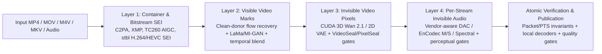

# Real video and audio removal roadmap

Updated: 2026-11-18. This execution contract defines how `remove-ai-watermarks`
maintains best-in-class open-source coverage across visible, container/bitstream,
audio-waveform, and video-pixel AI provenance marks on content the user owns or
generated. Third-party stock, marketplace, classifieds, non-AI plan branding,
and EU Annex 1 regulatory icons remain outside [project scope](legal-and-safety.md).

Companion references: [methods, libraries, and licenses](media-removal-research.md),
[provider verifiers](media-provider-verifiers.md), [sample corpus](media-sample-corpus.md),
[chronological evidence log](media-removal-evidence-log.md),
[audio/video coverage](audio-video-removal.md), and [Seedance study](seedance-video-study.md).

## Four-layer decoupled architecture

Every audio and video file is inspected and cleaned across four independent
layers so that container tags, bitstream SEI markers, visible overlays, video
pixel marks, and per-track audio marks are never conflated:

## Outcome and promotion contract

Promotion of any default or `auto`-routed audio/video mechanism requires:

1. **Hash-bound provenance**: Source and delivered bytes, model/checkpoint
   revisions, and parameters are bound in reproducible manifests; certified
   provider-oracle operating points are enforced by tests against
   [`data/evaluations/`](../data/evaluations/) (`video-synthid-oracle.csv`,
   `video-wan-oracle.csv`, `audio-synthid-oracle.csv`).
2. **Matched controls**: Every positive removal claim requires a positive
   untouched source and a positive matched codec/resampling control on the same
   verifier, plus clean controls that remain negative.
3. **Final-container verification**: Audio and video verdicts, exact frame/sample
   clocks, untouched sibling packet hashes, and multi-track stream coverage are
   checked on the final muxed container rather than intermediate buffers.
4. **Perceptual and worst-window quality gates**: Audio gates check SNR,
   clipping, active-window RMS (`worst_window_rms_ratio`), stereo Side/Mid
   drift, and phase-invariant `MR-STFT` / `64-band log-Mel` distances; video
   gates check `source_psnr_db`, `min_frame_psnr_db`, grayscale `source_ssim`,
   3-channel `source_color_ssim`, `min_frame_ssim`, 12-frame `worst_window_ssim`,
   and motion-compensated `temporal_residual_ratio`.
5. **Permissive open-source supply chain**: Shipped runtime dependencies and
   pinned weights use permissive licenses (`MIT`, `Apache-2.0`, `BSD`, or
   documented `CC-BY-4.0` opt-in). Non-commercial (`NTU S-Lab 1.0`,
   `Stability Community License`, `CC-BY-NC`) and `GPL-3.0` packages are never
   added to `pyproject.toml`; external tools are compared out-of-process via
   `scripts/media_removal_benchmark.py --external-outputs-dir`.

## Priority matrix

| Tier | Deliverable | Status | Verification / exit gate |
| --- | --- | --- | --- |
| **P0.1** | Fail-closed Google SynthID audio `auto` routing (`adaptive_auto_profiles` -> `("dac",)` when DAC is unavailable/multichannel; pre-strip vendor metadata preserved across `remove_video_all` stages) | **Shipped** | `tests/test_audio.py`, `tests/test_video_audio.py`; zero silent fallback to `encodec` on Google SynthID |
| **P0.2** | Data-backed oracle certification for `DAC` (`FIXED_QUANTIZERS=3`) and `Wan 2.1` (`strength=0.38`, `193/17` causal windows) on publication-cleared fixtures | **Shipped** | `data/evaluations/audio-synthid-oracle.csv`, `data/evaluations/video-wan-oracle.csv`, contract tests in `test_audio_dac.py` and `test_video_wan.py` |
| **P0.3** | Benchmark Schema v2: 4-layer visual quality gate (`source_color_ssim`, `min_frame_ssim`, `worst_window_ssim`), all-stream perceptual audio scoring, stereo 48 kHz music carrier, and `--external-outputs-dir` competitor comparator | **Shipped** | `scripts/media_removal_benchmark.py --builtin-suite --strict`, `tests/test_media_removal_benchmark.py`, `tests/test_video_fidelity_probe.py` |
| **P1.1** | Structural ISO-BMFF `stbl` H.264/HEVC `SEI user_data_unregistered` parser (`scan_isobmff_video_sei`) scoping Kling SEI detection and scrubbing strictly to video SEI NALs across the entire file | **Shipped** | `tests/test_video.py` (`framemd5` bit-exactness + late-file SEI detection + zero audio/slice byte mutation) |
| **P1.2** | Clean-donor optical-flow background propagation (`recover_unobscured_background`) with verified-context local-affine flow before `fill()` on moving/intermittent visible video marks | **Shipped** | `tests/test_video_temporal.py` (`> 6 dB` MSE reduction over single-frame inpainting on moving marks; hard scene-cut rejection) |
| **P1.3** | Full-bandwidth 48 kHz native stereo music codec (`facebook/encodec_48khz`, MIT) and high-capacity public video message parity (`ChunkySeal`, MIT) | **Next** | Paired 48 kHz stereo music perceptual benchmark vs `DAC` (`MR-STFT`, `Mel`, Side/Mid drift) and pinned local receiver round-trip |
| **P1.4** | Expanded visible AI-video mark templates (`Runway`, `Luma Dream Machine`, `Pika`, `PixVerse`, `Wan`) from publication-cleared native exports | **Next** | Positive TPR on native exports + zero false positives on clean negative video controls |
| **P2.1** | Fast temporal latent bottleneck (`TAEHV` Apache-2.0 / lightweight flow-guided 2D-to-3D adapter) for Apple Silicon MPS and consumer GPUs (`< 16 GiB`) | **Planned** | Close the `720p @ 24 fps` fidelity gap between `synthid` (`512 @ 12 fps`) and H100 `wan21-*` on `lite-003` and `VideoSeal 1.0` |
| **P2.2** | Out-of-process head-to-head benchmark run against `ShadowMarkDefense`, `pagedMark`, and `watermarks-remover` using `--external-outputs-dir` | **Planned** | Reproducible Markdown/JSON comparison across `AudioSeal`, `WavMark`, `Perth`, `VideoSeal 1.0`, and 4-layer clips |
| **P3** | Codec-trained latent audio/video robustness cohort (`NeuMark`, `DeltaMark`, `CRAW`) and held-out provider re-audits (`cartesia-api`, `resemble-api`, `openai-web`, `meta-web`) | **Research** | Held-out multi-generation survival/removal table without tuning parameters against live provider quota |

## Video tranche

Current video qualification separates container/SEI signals (`Kling` H.264 SEI
and `Dreamina` / `BytePlus` C2PA exports, which clear losslessly via
`remove_video_metadata`) from pixel-embedded watermarks (`Google Veo SynthID`,
consumer `CapCut Seedance`, and `Meta VideoSeal` / `PixelSeal`). Zero-noise
posterior-mode round trips (`CogVideoX`, `VidTok` FSQ, zero-noise
`AutoencoderKLWan`) retained pixel marks against matched silent controls and
serve strictly as structural baselines, whereas `wan21-synthid-experimental`
(`strength=0.38`) and `wan21-seedance-experimental` (`strength=0.12`) cleared
their respective provider checks at native resolution. Detailed chronological
experiment records remain in the
[evidence log](media-removal-evidence-log.md#video-tranche).

## Verification ladder

1. Local container, C2PA, TC260, and structural `stbl` H.264/HEVC SEI inspection.
2. Compatible pinned local decoders (`AudioSeal` 16/24/48 kHz, `WavMark`,
   `Perth v1`, experimental `SilentCipher`, `VideoSeal 0.0/1.0`, `PixelSeal`),
   calibrated on marked and clean controls.
3. Official provider watermark APIs (`elevenlabs-api`, `cartesia-api`,
   `resemble-api`) where documented, otherwise authorized provider web surfaces
   (`gemini-web`, `meta-web`, `kling-web`, `cartesia-web`, `microsoft-web`,
   `openai-web`) via `scripts/provider_oracles.py`.
4. Full saved-artifact and final-container verification, packet/PTS preservation
   on untouched tracks, and worst-window perceptual quality review.

Reuse a provider verdict only for the exact submitted SHA-256, verification
surface, and track scope. Quota refusals, login gates, and ambiguous replies
remain explicit `refused` or `indeterminate` states, never inferred negatives.
