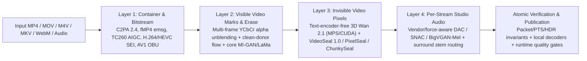

# Real video and audio removal roadmap

Updated: 2026-11-18. This execution contract defines how `remove-ai-watermarks`
achieves and verifies market-leading coverage across visible, container/bitstream,
audio-waveform, and video-pixel AI watermarks on user-generated or user-edited
content across all AI generators (free and paid tiers alike). Third-party stock,
marketplace, classifieds, non-AI editor branding on human footage, and EU Annex 1
regulatory icons remain outside [project scope](legal-and-safety.md).

Companion references: [methods, libraries, and licenses](media-removal-research.md),
[provider verifiers](media-provider-verifiers.md), [sample corpus](media-sample-corpus.md),
[chronological evidence log](media-removal-evidence-log.md),
[audio/video coverage](audio-video-removal.md), and [Seedance study](seedance-video-study.md).

## Four-layer decoupled architecture

Every audio and video file is inspected and cleaned across four independent
layers so that container tags, bitstream SEI/OBU markers, visible overlays, video
pixel marks, and per-track audio marks are never conflated:

## Outcome and promotion contract

Promotion of any default or `auto`-routed audio/video mechanism requires:

1. **Hash-bound provenance**: Source and delivered bytes, model/checkpoint
   revisions, and parameters are bound in reproducible manifests; certified
   provider-oracle operating points are enforced by tests against
   [`data/evaluations/`](../data/evaluations/) (`video-synthid-oracle.csv`,
   `video-wan-oracle.csv`, `audio-synthid-oracle.csv`).
2. **Matched controls & independent generations**: Every positive removal claim
   requires a positive untouched source and a positive matched codec/resampling
   control on the same verifier, plus clean controls that remain negative;
   denominators count independent generations rather than format derivatives.
3. **Final-container verification**: Audio and video verdicts, exact frame/sample
   clocks, untouched sibling packet hashes, and multi-track stream coverage are
   checked on the final muxed container through a unified saved-file evaluator
   shared by internal runs and `--external-outputs-dir` competitor runs.
4. **Runtime and benchmark quality gates**: Runtime `audio_quality_passed`
   enforces energy retention, full-scale peak/clipping bounds, active-window RMS
   (`worst_window_rms_ratio`), and stereo `max_side_mid_drift_db` while the
   benchmark additionally scores phase-invariant `MR-STFT` and `64-band log-Mel`
   distances; runtime `video_quality_passed` enforces `source_psnr_db`,
   `source_ssim`, `source_color_ssim`, `min_frame_ssim`, 12-frame
   `worst_window_ssim`, and motion-compensated `temporal_residual_ratio`.
5. **Permissive open-source supply chain**: Shipped runtime dependencies and
   pinned weights use permissive licenses (`MIT`, `Apache-2.0`, `BSD`, or
   documented `CC-BY-4.0` opt-in). Non-commercial (`NTU S-Lab 1.0`,
   `Stability Community License`, `MUSDB18-HQ` weights, `CC-BY-NC`, `OpenRAIL` /
   ARR-capped, `NVIDIA Open Model License`) and `GPL`/`AGPL` packages are never
   added to `pyproject.toml`; external tools are compared out-of-process via
   `scripts/media_removal_benchmark.py --external-outputs-dir`.

## Six-phase global master plan

| Phase | Deliverable | Status | Verification / exit gate |
| --- | --- | --- | --- |
| **Foundation (P0-P1.2)** | Fail-closed SynthID audio `auto` routing; oracle certification manifests (`DAC`, `Wan 2.1`); structural ISO-BMFF `stbl` H.264/HEVC SEI parser; clean-donor optical-flow background propagation (`recover_unobscured_background`) | **Shipped** | `tests/test_audio_dac.py`, `tests/test_video_wan.py`, `tests/test_video.py`, `tests/test_video_temporal.py` |
| **Phase 0** | Unified delivered-file evaluator (`Benchmark v3` across all 4-layer & multi-stream surfaces + `skipped_clean` / `control_stays_positive` / `bandwidth_kbps` parity); `ChunkySeal` (`1024`-bit `ConvNeXtV2` + `PixelDecoder`, MIT); runtime `max_side_mid_drift_db` & `worst_window_ssim` gates, lossless `.flac`/`.wav` `0.999` peak guard, and 10-bit HDR fail-safe in `video_invisible.py` | **Shipped** | `scripts/media_removal_benchmark.py --builtin-suite --strict`, `tests/test_video_message_models.py`, `tests/test_media_removal_benchmark.py` |
| **Phase 1** | Studio 44.1/48 kHz audio generation 2: `DAC 44.1k` benchmarked against `BigVGAN v2 + Mel-bottleneck`, `plain-bigvgan`, and `encodec48 (6k)` on 48 kHz stereo music & 16 kHz speech (`DAC` won across all axes); image-aligned `--vendor` / `--audio-vendor` / `--force` contract; `cpu`/`mps`/`cuda` audio acceleration; `5.1`/`7.1` stem decomposition & `16/24-bit` PCM preservation | **Shipped** | `tests/test_audio_dac.py`, `tests/test_av_roadmap_features.py`, zero `0 dBFS` FLAC clipping |
| **Phase 2** | Visible video v2 & `video erase`: self-calibrated multi-frame `YCrCb` reverse alpha unblending (`PyrLK + RANSAC` affine donor median, `+20.50 dB` ROI PSNR over Telea) + `donor_radius=12` clean-plate flow + `CUDA`/`CoreML` `MI-GAN`/`LaMa`; `dreamina` & `wan` video detectors (`10` marks) + multi-region support; `video erase --region --frames` (`remove_video_region`) | **Shipped** | `tests/test_visible_examples.py` (`10/10` video marks `90/90` frames), `tests/test_av_roadmap_features.py` |
| **Phase 3** | Memory-efficient `Wan 2.1 1.3B` & blind presence detection: CPU `UMT5-XXL` prompt offload (`~3.4 GiB` accelerator footprint vs `~14.8 GiB`), explicit `mps` support, 5-min `1080p` streaming budget, and blind `VideoSeal`/`PixelSeal`/`ChunkySeal` (`1024`-bit) presence detection (`video message detect` / `detect_video_watermark_presence`) | **Shipped** | `tests/test_video_wan.py`, `tests/test_av_roadmap_features.py` |
| **Phase 4** | Professional 10-bit HDR & container pipeline: end-to-end 16-bit `bgr48le` / `yuv420p10le`, `bt2020nc`, `smpte2084`, `arib-std-b67`, `libx265` `hvc1` & 10-bit `VP9`; selective lossless scrubbing of fMP4 `emsg`, MKV `application/c2pa` attachments (preserving fonts/cover art), and H.264/HEVC AI `SEI`; `.mkv` & `.m4v` unified in `remove_video_all` | **Shipped** | `tests/test_av_roadmap_features.py`, `tests/test_video.py`, `tests/test_metadata.py` |
| **Phase 5** | Unified multimodal UX & ecosystem: top-level `identify` / `all` / `erase` auto-dispatch across image/video/audio/text, `--json` across all `video *` commands, native `RAIWCleanAudio` (`AUDIO`) & `RAIWCleanVideo` (`IMAGE` + `fps` + `AUDIO`) tensor nodes in `ComfyUI-remove-ai-watermarks`, and `Clean video` / `Clean audio` / `Audio` tabs in `raiw-hf-space` | **Shipped** | `tests/test_av_roadmap_features.py`, `ComfyUI` (`34/34`), `raiw-hf-space` (`13/13` + rendered UI verification) |
| **Wave 2 (Stages 1-4)** | Zero-`UMT5-XXL` cached prompt embeddings, `1080p` / `8 GiB` compact-chunk `Wan 2.1`, single-pass `Wan 2.1` & `visible -> invisible` frame streaming; 18-mark video detector suite (`+8` real-asset-calibrated marks, `0/71` corpus FPs), simultaneous disjoint multi-mark removal (`_split_disjoint_masks`), `--trim-bumper`, and `erase --track`; AV1 `OBU_METADATA` (`ai_obu`) HDR-safe in-place `OBU_PADDING` scrubbing (`.mp4` `av01` + `.mkv`/`.webm` `V_AV1` with EBML `0xBF` `CRC-32`), `.webm` video/audio support, optional `videotoolbox`/`nvenc` encoders, multimodal `batch` + `--preset [lossless-fast\|balanced\|deep-clean]`; pure-PyTorch `SNAC 44.1 kHz` (`--method snac`, `q=3`, `3.85x` faster on `mps`) + `10/10` vs `1/10` head-to-head competitor benchmark | **Shipped** | `tests/test_av_wave2_features.py`, `tests/test_visible_examples.py` (`18/18` video marks `90/90` frames), `tests/test_video_wan.py` |
| **Wave 3 (HDR + Temporal Inpainting)** | End-to-end 10-bit HDR (`yuv420p10le`, `BT.2020`, `PQ`/`HLG`, `bgr48le` float32 pipeline) across `video invisible` (`sd-vae` + `uint16` temporal stabilization), `Wan 2.1`, and single-pass `remove_video_all`; background-locked bidirectional multi-frame temporal video inpainting (`stabilize_filled_frame_bidirectional`), FFT coarse flow pre-alignment (`_coarse_shifted_flow`) for `>4 px` pans, strided donor selection + transitive clean-plate propagation, and opaque-core support fix in `estimate_clip_alpha_matte` | **Shipped** | `tests/test_av_wave3_features.py`, `tests/test_video_temporal.py`, `tests/test_video_wan.py` |
| **Wave 12 (`v0.74.0`)** | Oracle-certified `SNAC 44.1 kHz + preserve_hf_hz=14000.0` default on `>= 44.1 kHz` audio; `--native-guide` 512p-guided native-resolution 2D SynthID (`32.48 dB` PSNR), pyramid-scaled optical flow (`<= 512`), conditional `> 768p` VAE tiling, and `--wan-steps` 3D step control; 23-mark visible video suite (`+5` marks: `pixverse`, `luma`, `heygen`, `sync_labs`, `tiktok_ai` + international `Qwen`), clean-segment fast-forward, and selective H.264 keyframe GOP stream-copy; `signal-discovery` C2PA/XMP/TC260 detect/strip parity fixes | **Shipped** | `tests/test_av_wave12_v074.py`, `tests/test_visible_examples.py` (`23/23` video marks `90/90` frames), `data/evaluations/audio-synthid-oracle.csv` |

## Video tranche

Current video qualification separates container/SEI signals (`Kling` H.264 SEI
and `Dreamina` / `BytePlus` C2PA exports, which clear losslessly via
`remove_video_metadata`) from pixel-embedded watermarks (`Google Veo SynthID`,
consumer `CapCut Seedance`, and `Meta VideoSeal 1.0` / `PixelSeal` / `ChunkySeal`).
Zero-noise posterior-mode round trips (`CogVideoX`, `VidTok` FSQ, zero-noise
`AutoencoderKLWan`) retained pixel marks against matched silent controls and
serve strictly as structural baselines, whereas `wan21-synthid-experimental`
(`strength=0.38`) and `wan21-seedance-experimental` (`strength=0.12`) cleared
their respective provider checks at native resolution. Detailed chronological
experiment records remain in the
[evidence log](media-removal-evidence-log.md#video-tranche).

## Verification ladder

1. Local container, C2PA, TC260, and structural `stbl` H.264/HEVC SEI inspection.
2. Compatible pinned local decoders (`AudioSeal` 16/24/48 kHz, `WavMark`,
   `Perth v1`, experimental `SilentCipher`, `VideoSeal 1.0` 256-bit, `PixelSeal`
   256-bit, `ChunkySeal` 1024-bit), calibrated on marked and clean controls.
3. Official provider watermark APIs (`elevenlabs-api`, `cartesia-api`,
   `resemble-api`) where documented, otherwise authorized provider web surfaces
   (`gemini-web`, `meta-web`, `kling-web`, `cartesia-web`, `microsoft-web`,
   `openai-web`) via `scripts/provider_oracles.py`.
4. Full saved-artifact and final-container verification, packet/PTS preservation
   on untouched tracks, and worst-window perceptual quality review.

Reuse a provider verdict only for the exact submitted SHA-256, verification
surface, and track scope. Quota refusals, login gates, and ambiguous replies
remain explicit `refused` or `indeterminate` states, never inferred negatives.
