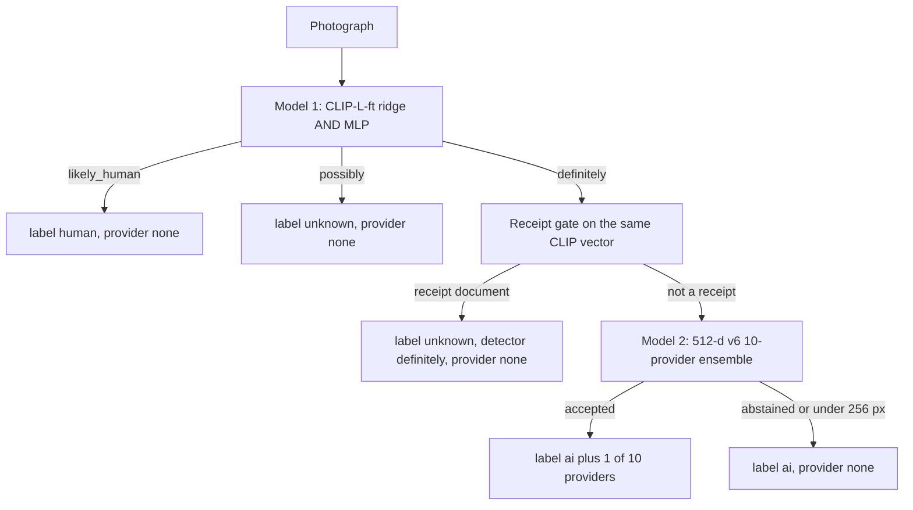

---
language:
  - en
license: apache-2.0
library_name: transformers
pipeline_tag: image-classification
base_model: openai/clip-vit-large-patch14
inference: false
tags:
  - clip
  - image-classification
  - ai-generated-content
  - photo
  - provider-attribution
datasets:
  - detection-datasets/coco
---

# Photo AI-versus-camera classifier

Two stages, one call. Model 1 decides whether a **photograph** looks generated
or camera-like. When Model 1 returns `definitely` and the receipt-document gate
clears the image, Model 2 attributes the likely rendering pipeline across 10 AI
provider families (`openai`, `google`, `bytedance`, `flux`, `stable_diffusion`,
`meta`, `midjourney`, `ideogram`, `firefly`, `xai`) or abstains to `None`.

This is not a SynthID decoder. It is not provenance. It is not a universal
"AI or not" detector for UI or digital art. Receipt photographs are detected by
the bundled receipt gate and abstain to `unknown` rather than a false `ai`.
The Python package
[`remove-ai-watermarks`](https://github.com/wiltodelta/remove-ai-watermarks)
loads these files through the explicit `classify` extra. `identify` never starts
this model, including after a no-signal metadata scan.

Library guide:
[photo pixel classification](https://github.com/wiltodelta/remove-ai-watermarks/blob/main/docs/photo-classify.md).
Research archive:
[AI-generated image classifiers](https://github.com/wiltodelta/remove-ai-watermarks/blob/main/docs/ai-generated-image-classifiers.md).
The demo Space
[`wiltodelta/remove-ai-watermarks`](https://huggingface.co/spaces/wiltodelta/remove-ai-watermarks)
is a watermark-removal UI, not this classifier.

The training catalog is not in this Hub repository and is not on GitHub.

## Intended use

Use it when you have a photographic still and want a pixel opinion after
metadata is gone:

- `label=ai` plus `provider` in `openai`, `google`, `bytedance`, `flux`,
  `stable_diffusion`, `meta`, `midjourney`, `ideogram`, `firefly`, or `xai`
  when Model 1 is `definitely`, the receipt gate misses, and Model 2 clears its
  calibrated acceptance threshold
- `label=ai, provider=None` on generators outside those 10 families (such as
  Qwen, Kling, Yuanbao, Hailuo, or Hunyuan), when Model 2 abstains, or when
  512-d features cannot be extracted (for example below 256x256)
- `label=human` on camera photographs at a low false-positive rate
- `label=unknown` when Model 1 is `possibly`, or when the receipt gate abstains
  a receipt photograph (`detector=definitely, label=unknown, provider=None`)

Do not use it to assert that a file is clean. Do not use it as a legal
authorship test. Do not treat `provider` as a decoded watermark payload.

## Approach

Content embeddings and physics-grounded pixel residuals answer different
questions.

CLIP-L, after a light vision-block fine-tune, separates **generated
photographs** from **camera photographs**. It does not reliably separate
generated photographs from UI, charts, or illustration; receipts live inside
the AI region too, which is why the shipped receipt gate abstains them on the
`definitely` path instead of trying to force Model 1 to solve document routing.
A ridge probe trained on that embedding at a 1% Open Images false-positive cut
is paired with a small MLP (`768-512-128-1`) via logical AND to form the
`definitely` gate.

The receipt gate ships in this repository under the stable name
`receipt-gate.npz` with its threshold inside the artifact (plus
`receipt-gate-2026-09-02.npz` for legacy compatibility).

Model 2 (`multi-provider-source-v6.npz`, SHA-256
`87868eea08b8b811999f675186b82b067c4de655981cb7f25114aac00b1dd284`) runs in
pure NumPy (`allow_pickle=False`) on a 512-dimensional physics-grounded
descriptor (`112-d` adaptive SRM residuals + `128-d` phase-resolved modulo-8/16
sublattice and `8x8` DCT comb features + `144-d` Moisan periodic-plus-smooth
spectral profiles + `96-d` CFA/shot-noise/chromatic-aberration sensor cues +
`32-d` codec and geometry regime features). It decouples regime-standardized
supported-AI acceptance from 10-way provider attribution.



Provider attribution tracks the **renderer**, not the front-end UI. Bing Image
Creator rows rendered by DALL-E score as `openai`; Microsoft Designer rows
rendered by Imagen score as `google`. Microsoft has no separate pixel class and
remains a C2PA metadata attribution. `bytedance` names the shared Doubao and
Jimeng generator lineage. Unsupported Chinese generators (Qwen, Kling, Yuanbao,
Hailuo, Hunyuan) are rejected by the acceptance gate and publish
`provider=None`.

## Architecture

### Model 1

- Backbone: `openai/clip-vit-large-patch14`
- Fine-tune: last two vision blocks, visual projection, post-layernorm
- Preprocess: 224 letterbox, pad RGB `(123, 117, 104)`, BICUBIC, L2-normalized
  vision features
- Ridge: linear probe on 768-d vectors, threshold `thr_oi_1pct = 0.3056`
- MLP: `768-512-128-1` with dropout `0.3 / 0.1`, threshold `5.9586`
- `definitely` = ridge AND MLP; `possibly` = either; public `label` is `ai`
  only on `definitely` (when not abstained by the receipt gate)

### Model 2

- Artifact: `multi-provider-source-v6.npz` (`schema = multi-provider-source-v5`,
  SHA-256 `87868eea08b8b811999f675186b82b067c4de655981cb7f25114aac00b1dd284`)
- Input: 512-d physics-grounded residual/sublattice/spectral/sensor/regime
  vector, or abstain to `provider=None` when smaller than `256x256`
- Ensemble: 12-output Regime-FiLM residual MLP trunks + packed binary
  `HistGradientBoosting` specialists, 2D concordance/veto/pairwise gates, an
  11-channel acceptance detector standardized by a 2-layer heteroscedastic skip
  regime null, and a 10-way `LayerNorm + SiLU` skip attribution head across
  `openai`, `google`, `bytedance`, `flux`, `stable_diffusion`, `meta`,
  `midjourney`, `ideogram`, `firefly`, and `xai`

## Cascade evaluation

Model 1 + `receipt-gate.npz` + `multi-provider-source-v6.npz` measured on the
photographic cascade benchmark (reporting both the subset strictly disjoint
from all `v6` training and calibration splits and the full benchmark):

| Cell | Model 1 `definitely` | Model 2 conditional (strictly unseen by `v6`) | Model 2 conditional (all rows) |
| --- | ---: | ---: | ---: |
| AI-test (`n=1,847`) | 92.4% (`1,707/1,847`) | - | - |
| Open Images fresh (`n=3,000`, expect `None`) | 1.3% (`38/3,000`) | **100.0%** abstain (`8/8`, `0` false provider labels) | **100.0%** abstain (`38/38`, `0` false provider labels) |
| Kodak (`n=24`) | 0.0% (`0/24`) | `0/8` ungated false labels | `0/24` ungated false labels |
| Field phone receipts (`n=60`, `receipt-gate.npz`) | 60.0% (`36/60` -> all `36` gated to `unknown`) | `0/17` ungated false labels | `0/60` ungated false labels |
| OpenAI (`openai`) | 92.4% (`352/381`) | **92.7%** (`102/110`) | **95.2%** (`335/352`) |
| Google (`google`) | 90.5% (`341/377`) | **87.9%** (`109/124`) | **91.2%** (`311/341`) |
| ByteDance (`bytedance`, Doubao+Jimeng) | 97.6% (`621/636`) | **81.4%** (`232/285`, `0` cross-provider errors) | **88.7%** (`551/621`, `0` cross-provider errors) |
| Meta (`meta`, pooled `v2 + v3`) | 71.8% (`199/277`) | **100.0%** (`81/81`) | **100.0%** (`199/199`) |
| FLUX hold-out (`flux`) | 83.0% (`249/300`) | **95.5%** (`63/66` named `flux`) | **94.8%** (`236/249` named `flux`) |
| Unsupported China generators (`tc260` rest, expect `None`) | 95.6% (`109/114`) | **80.6%** abstain (`87/108` `None`) | **80.7%** abstain (`88/109` `None`) |

Standalone 10-provider metrics across all 10 provider families (`locked_test`
`N=10,585`, out-of-distribution negatives, and post-processing perturbations)
are documented in
[`source-classify-hf/README.md`](https://github.com/wiltodelta/remove-ai-watermarks/blob/main/docs/source-classify-hf/README.md).

## Limitations

- **Photographs only.** UI, scans of forms, maps, and community digital art sit
  in the AI region of CLIP-L. Receipt photographs abstain through
  `receipt-gate.npz` (`unknown` with `detector=definitely`). A photorealistic
  AI receipt can still score as `human`.
- **Not SynthID and not provenance.** A `provider=google` or `provider=openai`
  result means the pixels match that rendering/export pipeline, not that an
  invisible watermark was decoded. Use `identify` for C2PA, IPTC, and visible
  marks.
- **256x256 minimum for Model 2.** Images with shortest side below `256` px
  cannot yield 512-d features; Model 1 still runs and `provider` abstains to
  `None`.
- **Post-processing sensitivity.** Heavy crop, resize, screenshot recapture, or
  aggressive recompression degrades pixel source signatures toward abstention
  (`provider=None`).
- **Microsoft has no pixel class.** Route by renderer, or use C2PA for the
  front-end product name.

## How to use

```bash
uv tool install --force "remove-ai-watermarks[classify]"
remove-ai-watermarks classify image.png
remove-ai-watermarks classify image.png --json
```

```python
from pathlib import Path
from remove_ai_watermarks.classify import classify_pixels

result = classify_pixels(Path("image.png"))
# result.label, result.detector, result.provider
```

`device` is a library parameter (`None` / `"auto"` / `"cpu"` / `"cuda"`), not a
CLI option. `backend="onnx"` selects the optional CPU-only FP32 vision runtime
(`pip install "remove-ai-watermarks[classify-onnx]"`).

## Files in this repository

| File | Role |
| --- | --- |
| `clip-l-ft.pt` | HeadedCLIP state dict (CLIP-L plus unused linear head) |
| `clip-l-ft-vision-fp32.onnx` | Static batch-one vision tower and projection for `backend="onnx"` |
| `probe-weights-clip-l-ft.npz` | Ridge mean, scale, weights, `thr_oi_1pct` |
| `detector.pt` | Freeze MLP (`768-512-128-1`) |
| `multi-provider-source-v6.npz` | Pure-NumPy 512-d 10-provider Model 2 bundle (SHA-256 `87868eea08b8b811999f675186b82b067c4de655981cb7f25114aac00b1dd284`) |
| `receipt-gate.npz` | Model-side receipt-document gate with bundled threshold |
| `receipt-gate-2026-09-02.npz` | Legacy receipt-gate artifact kept for pre-0.39 compatibility |
| `operating-point.json` | Freeze metadata, thresholds, provider classes, and file list |

## License

Apache-2.0 for the trained heads, NumPy ensemble, and this card. CLIP-L
inherits its upstream license from
[`openai/clip-vit-large-patch14`](https://huggingface.co/openai/clip-vit-large-patch14).
