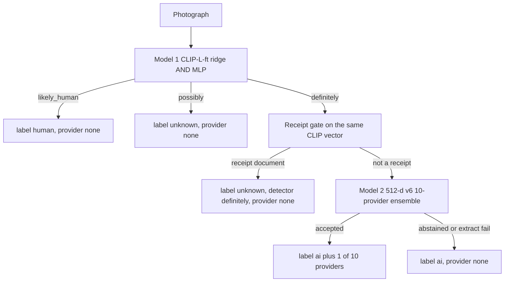

# Photo pixel classification

`classify` gives a pixel opinion on a **photograph**: camera-like, generated,
or unknown, and optionally which of 10 AI rendering pipelines it resembles. It
is a separate command from `identify`. Metadata inspection never starts it.

This page is the library guide. The Hugging Face model card is the same freeze
written for Hub publication: [photo-classify-hf/README.md](photo-classify-hf/README.md).
Campaign notes and historical ablations live in
[AI-generated image classifiers](ai-generated-image-classifiers.md).

## When to use it

Use `identify` for C2PA, IPTC, visible marks, and other provenance. Use
`classify` when those signals are gone and the file is still a photograph.

Do not use `classify` to prove a file is clean. Do not use it on UI or digital
art. Receipt photographs are detected by the receipt-document gate and abstain
to `unknown` instead of a false `ai`; they are still not a supported verdict.
Do not treat `provider=google` or `provider=openai` as a decoded SynthID or
watermark payload.

## Install and run

```bash
uv tool install --force "remove-ai-watermarks[classify]"
remove-ai-watermarks classify image.png
remove-ai-watermarks classify image.png --json
```

```python
from pathlib import Path
from remove_ai_watermarks.classify import classify_pixels

result = classify_pixels(Path("image.png"))
print(result.label, result.detector, result.provider)
```

Missing extra raises `RuntimeError` with
`pip install 'remove-ai-watermarks[classify]'`. `device` is a library
parameter (`None` / `"auto"` / `"cpu"` / `"cuda"`), not a CLI option. The
explicit `backend="onnx"` path is CPU-only and requires
`clip-l-ft-vision-fp32.onnx` in `RAIW_CLASSIFY_WEIGHTS` or the pinned Hub
snapshot. PyTorch remains the default. Install the optional runtime with
`pip install 'remove-ai-watermarks[classify-onnx]'`.

Weights are not in git. First call downloads
[`wiltodelta/raiw-photo-classify`](https://huggingface.co/wiltodelta/raiw-photo-classify)
at the freeze revision pinned in `classify.py`, or reads
`RAIW_CLASSIFY_WEIGHTS` if that directory already has `clip-l-ft.pt`,
`probe-weights-clip-l-ft.npz`, `detector.pt`, and
`multi-provider-source-v6.npz`. The training catalog is not published with the
package. Deployments that pre-cache the snapshot for offline resolution must
request exactly `classify.WEIGHTS_ALLOW_PATTERNS`. That exported list covers
both backends; the online runtime narrows its download to the selected model
plus the shared heads. A partial offline pre-cache fails resolution, even for
files the runtime would otherwise fall back on.

Generate the optional vision-only graph from the exact frozen checkpoint:

```bash
uv run --with onnx python scripts/export_photo_classify_onnx.py \
  --checkpoint /path/to/clip-l-ft.pt \
  --out /path/to/clip-l-ft-vision-fp32.onnx
```

## What one call returns

One request runs both stages. The receipt gate and Model 2 run only after
Model 1 is `definitely`.



| Field | Values | Meaning |
| --- | --- | --- |
| `label` | `ai`, `human`, `unknown` | Public verdict. `ai` only on `definitely` |
| `domain` | `photo` | This freeze is photographic only |
| `detector` | `definitely`, `possibly`, `likely_human` | Raw Model 1 gate |
| `provider` | `openai`, `google`, `bytedance`, `flux`, `stable_diffusion`, `meta`, `midjourney`, `ideogram`, `firefly`, `xai`, or `None` | Model 2, only if `label` is `ai` |

`unknown` with `detector=definitely` is the receipt-document gate abstaining:
the file looked AI-generated to Model 1 and like a receipt photograph to the
gate, so no verdict is published and no provider is read.

`human` is camera-like under this contract, not a proof of authorship.
`unknown` is `possibly`, or a domain this freeze does not support.
`provider=None` on an `ai` file means the generator is outside the 10 supported
families (for example Qwen, Kling, Yuanbao, Hailuo, or Hunyuan), the image did
not clear Model 2's calibrated acceptance threshold, or 512-d feature
extraction refused the file (below `256x256`).

## Approach

CLIP-L content embeddings separate generated photographs from camera
photographs. They do not separate generated photographs from receipts or UI.
A ridge on fine-tuned CLIP-L (last two vision blocks, 224 letterbox) is Model
1. A small MLP on the same vectors, ANDed with the ridge, is the freeze
`definitely` gate.

Provider attribution uses the pure-NumPy `multi-provider-source-v6.npz` bundle
on a 512-dimensional physics-grounded descriptor (adaptive SRM residuals,
phase-resolved modulo-8/16 sublattice and `8x8` DCT comb features, Moisan
spectral profiles, CFA/sensor cues, and a 32-d codec/geometry regime block). It
decouples regime-standardized supported-AI acceptance from 10-way provider
attribution and runs only after Model 1 returns `definitely` and the receipt
gate misses.

Provider names the renderer, not the product UI. Bing Image Creator rendered by
DALL-E scores as `openai`; Microsoft Designer rendered by Imagen scores as
`google`. There is no Microsoft pixel class (a head trained on Microsoft-brand
rows recognizes 8% of its own test cell and names a fresh Copilot generation
`openai`): Microsoft's products render with other vendors' models, so Microsoft
attribution is metadata, not pixels. `bytedance` is the shared Doubao and
Jimeng generator lineage. Unsupported Chinese generators (Qwen, Yuanbao, Kling,
Hailuo, Hunyuan) abstain to `provider=None`.

## Evaluation

Model 1 + `receipt-gate.npz` + `multi-provider-source-v6.npz` on the
photographic cascade benchmark (reporting both the subset strictly disjoint
from all `v6` training/calibration splits and all rows):

| Stage | Cell | Result (strictly unseen by `v6`) | Result (all rows) |
| --- | --- | ---: | ---: |
| Model 1 `definitely` | AI-test | 92.5% (`630/681`) | 92.4% (`1,707/1,847`) |
| Model 1 `definitely` | Open Images fresh | 1.1% (`8/702`) | 1.3% (`38/3,000`) |
| Model 1 `definitely` | Kodak | `0/8` | `0/24` |
| Model 1 `definitely` | FLUX hold-out | 84.6% (`66/78`) | 83.0% (`249/300`) |
| Model 2 conditional | Open Images fresh (expect `None`) | **100.0%** abstain (`8/8`, `0` false labels) | **100.0%** abstain (`38/38`, `0` false labels) |
| Model 2 conditional | OpenAI (`openai`) | **92.7%** (`102/110`) | **95.2%** (`335/352`) |
| Model 2 conditional | Google (`google`) | **87.9%** (`109/124`) | **91.2%** (`311/341`) |
| Model 2 conditional | ByteDance (`bytedance`, Doubao+Jimeng) | **81.4%** (`232/285`, `0` cross-provider errors) | **88.7%** (`551/621`, `0` cross-provider errors) |
| Model 2 conditional | Meta (`meta`, pooled `v2 + v3`) | **100.0%** (`81/81`) | **100.0%** (`199/199`) |
| Model 2 conditional | FLUX hold-out (`flux`) | **95.5%** (`63/66`) | **94.8%** (`236/249`) |
| Model 2 conditional | Unsupported China generators (`tc260` rest, expect `None`) | **80.6%** abstain (`87/108`) | **80.7%** abstain (`88/109`) |

## Receipt-document gate

Added 2026-09-02 and updated 2026-09-07 under the stable name
`receipt-gate.npz`. A linear head on the CLIP-L-ft vector Model 1 already
computes, certified on CORD validation plus a synthetic holdout with no
field-receipt pixels in threshold selection. On `definitely` only: a hit
publishes `unknown` and skips the 512-d Model 2 pass.

| Cell | Result |
| --- | ---: |
| Field phone receipts gated (`receipt-gate.npz`) | **59/59** (`57/59` on 2026-09-02 fallback) |
| CORD photographs (99) | **0/99** false `ai` |
| `ai_test` `definitely` cost | `5/1,847` (`0.27%`) |

The head ships with the model under the stable name `receipt-gate.npz` in the
Hub snapshot with the threshold inside the artifact (legacy dated spelling
still readable, package asset as the fallback for pre-gate freezes); the
operating point records it in
[photo-classify-hf/operating-point.json](photo-classify-hf/operating-point.json).

## Limits

- Receipts abstain through `receipt-gate.npz`; a photorealistic AI receipt can
  still score as `human`. UI, scans, maps, and community art remain out of
  contract.
- Not SynthID, not C2PA, not `is_ai_generated`.
- Images with shortest side under `256` px cannot yield 512-d features, so
  `provider` abstains to `None`.
- Heavy crop, resize, screenshot recapture, or aggressive recompression
  degrades 512-d source signatures toward abstention (`provider=None`).
- Unsupported generators outside the 10 named families (for example Qwen,
  Yuanbao, Kling, Hailuo, Hunyuan) abstain to `provider=None`.

`identify`, `has_invisible_target`, `all`, and `invisible` do not import this
module. A no-signal provenance result stays unknown until you call `classify`
yourself.

Model 1 training data and cache layout are documented in
[photo-classify-training.md](photo-classify-training.md); standalone 10-provider
Model 2 details live in [source-classify.md](source-classify.md).
