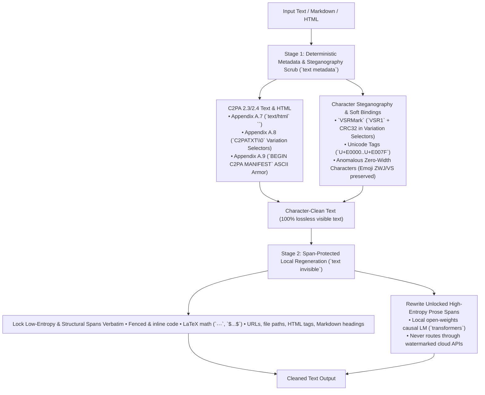

# Text Watermark and Provenance Research

This document records the architecture, binary framing, statistical mechanics,
and empirical removal benchmarks for AI text provenance and LLM token
watermarks supported by `remove-ai-watermarks`.

## Taxonomy of text provenance and watermarks

AI text provenance signals fall into four distinct technical layers with
fundamentally different detection and removal properties:



| Layer | Signal family | Examples | Local detection | Removal mechanism | Fidelity |
| --- | --- | --- | --- | --- | --- |
| **1. Container & character-wrapper C2PA** | Cryptographic JUMBF manifest embedded in HTML or invisible Unicode suffixes/comments | C2PA 2.3/2.4 Appendix A.7 (`text/html`), Appendix A.8 (`C2PATXT\0`), Appendix A.9 (`-----BEGIN C2PA MANIFEST-----`) | **Deterministic (100%)** via JUMBF / `c2pa-rs` inspection | Exact structural strip (`text metadata`) | **Lossless** on visible prose and code |
| **2. Character-level steganography & soft bindings** | Invisible codepoints interleaved with or appended to visible characters | `VSRMark` (`com.cognitive-proof.vsrmark.1`), Unicode Tags (`U+E0000`..`U+E007F`), zero-width steganography (`U+200B`..`U+200D`, `U+2060`..`U+2064`, `U+FEFF`) | **Deterministic (100%)** via byte bijection, magic header, and CRC32 check | Emoji-preserving codepoint strip (`text metadata`) | **Lossless** on visible prose and code |
| **3. Token-level statistical LLM watermarks** | Keyed pseudorandom bias or tournament selection during autoregressive token sampling | Google `SynthID-Text`, Anthropic **Claude Fable 5.1/5.2 & Mythos 5.1/5.2**, OpenAI **GPT-6 Astra `textGrain`**, KGW Red-Green List, Unigram | **Key-gated** (requires the provider's secret key or private detector endpoint; unkeyed text carries no local statistical proof) | Span-protected prose regeneration with an unwatermarked local model (`text invisible`) | **Semantic-preserving** (rewrites prose tokens; locks code, math, URLs, and paths byte-for-byte) |
| **4. Post-hoc stylometric / perplexity classifiers** | Unkeyed statistical classifiers over token entropy and burstiness | GPTZero, Originality.ai, Binoculars | Not provenance (high false-positive rate on structured and non-native prose) | Out of scope (stylometric guessing is not a watermark) | N/A |

---

## Layer 1 & 2: Deterministic text provenance and character steganography

### Shared byte-to-Variation-Selector bijection (`C2PATXT` and `VSRMark`)

Both C2PA 2.3/2.4 Appendix A.8 (`C2PATextManifestWrapper`) and `VSRMark`
(`com.cognitive-proof.vsrmark.1`, entry 39 in the C2PA Soft Binding Algorithm
Registry synced into
[`_generated_c2pa_soft_bindings.py`](../src/remove_ai_watermarks/_internal/_generated_c2pa_soft_bindings.py))
map each byte $b \in \{0, \dots, 255\}$ bijectively onto the 256 Unicode
Variation Selectors:

$$
\operatorname{VS}(b) = \begin{cases}
\text{U+FE00} + b & \text{if } 0 \le b \le 15 \quad (\text{VS1..VS16: U+FE00..U+FE0F}) \\
\text{U+E0100} + (b - 16) & \text{if } 16 \le b \le 255 \quad (\text{VS17..VS256: U+E0100..U+E01EF})
\end{cases}
$$

And the inverse byte recovery for codepoint $c$ is:

$$
\operatorname{Byte}(c) = \begin{cases}
c - \text{0xFE00} & \text{if } \text{0xFE00} \le c \le \text{0xFE0F} \\
c - \text{0xE0100} + 16 & \text{if } \text{0xE0100} \le c \le \text{0xE01EF}
\end{cases}
$$

Every codepoint in both ranges has Unicode General Category `Mn` (Nonspacing
Mark) and `Default_Ignorable_Code_Point=True`, rendering with zero advance
width in standard text renderers while surviving UTF-8 copy-paste.

### C2PA 2.3/2.4 Appendix A.8: Plain text (`C2PATextManifestWrapper` / `C2PATXT`)

Defined in C2PA Specification v2.3/v2.4 Appendix A.8 (and implemented by
reference libraries such as `encypherai/c2pa-text` and `dualeai/c2patxt`):

1. The carrier text is normalized to Unicode Normalization Form C (NFC) before
   hashing and manifest embedding.
2. The wrapper is appended at the very end of the text, beginning with a single
   `U+FEFF` (`ZERO WIDTH NO-BREAK SPACE` / BOM) sentinel followed by a
   contiguous sequence of Variation Selectors encoding the binary
   `C2PATextManifestWrapper` frame:

| Offset | Field | Type (`struct`) | Value / constraint |
| --- | --- | --- | --- |
| `0..7` | `magic` | `8s` | `b"C2PATXT\x00"` (`43 32 50 41 54 58 54 00`) |
| `8` | `version` | `B` (`uint8`) | `1` (`0x01`) |
| `9..12` | `manifestLength` | `>I` (`uint32` big-endian) | $N$ (byte length of the JUMBF Manifest Store) |
| `13..13+N` | `manifest` | ` bytes` | Raw C2PA JUMBF Manifest Store (`c2pa` superbox) |
| `13+N..` | `padding` | `bytes` (optional) | Zero-padding bytes reserved for in-place manifest updates |

Because `manifest` is a standard JUMBF Manifest Store, extracting those $N$
bytes allows direct inspection through `c2pa.py` (`_parse_c2pa_chunk` and
registry matching) to surface the issuer, AI tool, `trainedAlgorithmicMedia`
digital source type, and soft-binding declarations before stripping the
trailing `U+FEFF` + Variation Selector block.

### C2PA 2.3/2.4 Appendix A.9: Structured text ASCII Armor

For structured text formats that strip or reject non-printable Unicode but
support comments or front matter (Markdown, source code, YAML/TOML, XML, SVG,
CSS), C2PA Appendix A.9 specifies an ASCII-armored manifest block:

```text
-----BEGIN C2PA MANIFEST-----
data:application/c2pa;base64,<base64-encoded JUMBF Manifest Store>
-----END C2PA MANIFEST-----
```

The body between the headers holds either an external manifest URI
(`https://...`) or an inline `data:application/c2pa;base64,...` URI (or raw
base64 JUMBF). When inline JUMBF bytes are present, `remove-ai-watermarks`
decodes and inspects the JUMBF payload for AI provenance signals and removes
the block (along with an enclosing HTML/Markdown comment `<!-- ... -->` when
the comment contains only the C2PA manifest block).

### C2PA 2.3/2.4 Appendix A.7: HTML (`text/html`)

For HTML documents, C2PA Appendix A.7 embeds provenance inside `<head>` via one
of two elements:

- Inline JUMBF manifest store:
  `<script type="application/c2pa">data:application/c2pa;base64,...</script>`
  (or raw base64 inside the `<script type="application/c2pa">` element).
- External manifest reference:
  `<link rel="c2pa-manifest" href="https://...">`.

Per C2PA Appendix A.7, an HTML `<head>` containing more than one C2PA manifest
element is invalid and must be flagged as a validation warning (`multiple_c2pa_head_elements`).

### `VSRMark` (`com.cognitive-proof.vsrmark.1`)

Registered in the C2PA Soft Binding Algorithm Registry (`entry 39`,
`https://github.com/Cognitive-Proof/VSRMark`), `VSRMark` distributes its
Variation Selector payload across the visible text rather than appending a
contiguous suffix:

1. One Variation Selector is inserted immediately after each visible carrier
   character (grapheme cluster), requiring at least $N + 11$ visible characters
   for an $N$-byte UTF-8 payload.
2. Extracting the interleaved Variation Selectors in document order and
   inverting $\operatorname{VS}(b)$ yields a binary stream containing the
   11-byte-overhead big-endian `VSR1` frame:

| Offset | Field | Type (`struct`) | Value / constraint |
| --- | --- | --- | --- |
| `0..3` | `magic` | `4s` | `b"VSR1"` (`56 53 52 31`) |
| `4` | `version` | `B` (`uint8`) | `1` (`0x01`) |
| `5..6` | `length` | `>H` (`uint16` big-endian) | $N \in [0, 65535]$ |
| `7..7+N` | `payload` | `bytes` | UTF-8 provenance payload (e.g. manifest ID, author, or JSON claim) |
| `7+N..11+N` | `crc32` | `>I` (`uint32` big-endian) | `zlib.crc32(magic + version + length + payload) & 0xFFFFFFFF` |

Validating both the `b"VSR1"` header and the 32-bit CRC guarantees zero false
positives on ordinary text while recovering the exact embedded payload string.

### Unicode Tags (`U+E0000`..`U+E007F`), Private Use Area, and zero-width steganography

- **Unicode Tags (`U+E0000`..`U+E007F`)**: Map printable ASCII characters
  `0x20..0x7E` to `U+E0020..U+E007E` (`cp = 0xE0000 + ascii_byte`), optionally
  framed by `U+E0001` (`LANGUAGE TAG`) and `U+E007F` (`CANCEL TAG`). Used by
  hidden-prompt and provenance injectors because tag characters are invisible
  in browsers and editors.
- **Zero-width, deprecated format, filler, and PUA steganography**:
  Binary or hex payloads encoded via runs or combinations of `U+200B` (`ZERO WIDTH SPACE`),
  `U+200C` (`ZERO WIDTH NON-JOINER`), `U+200D` (`ZERO WIDTH JOINER`), `U+2060`
  (`WORD JOINER`), `U+2061`..`U+2064` (invisible math operators), `U+00AD` (`SOFT HYPHEN`),
  `U+034F` (`COMBINING GRAPHEME JOINER`), `U+061C` (`ARABIC LETTER MARK`),
  `U+115F..U+1160` / `U+3164` / `U+FFA0` (Hangul fillers), `U+17B4..U+17B5`
  (Khmer inherent vowels), `U+180B..U+180F` (Mongolian free variation selectors
  and vowel separator), `U+200E..U+200F` / `U+202A..U+202E` / `U+2066..U+2069`
  (bidirectional controls), `U+206A..U+206F` (deprecated format controls used as
  hex nibbles by `jaceddd/text_watermark`), `U+FFF9..U+FFFB` (interlinear
  annotation controls), mid-text `U+FEFF`, and Unicode Private Use Area markers
  (`U+E000..U+F8FF`, `U+F0000..U+FFFFD`, `U+100000..U+10FFFD`, including ChatGPT
  citation delimiters `U+E200..U+E203`).
- **Emoji, subdivision flag, and joining-script preservation invariants**:
  - A naive strip of `U+E0000`..`U+E007F` breaks ISO 3166-2 regional subdivision
    flags (England `🏴󠁧󠁢󠁥󠁮󠁧󠁿`, Scotland `🏴󠁧󠁢󠁳󠁣󠁴󠁿`, Wales `🏴󠁧󠁢󠁷󠁬󠁳󠁿`), which are encoded as
    `U+1F3F4` (`WAVING BLACK FLAG`) followed by `U+E0020..U+E007E` tag characters
    and terminated by `U+E007F` (`CANCEL TAG`). [`text.py`](../src/remove_ai_watermarks/text.py)
    identifies and preserves valid `U+1F3F4..U+E007F` subdivision flag sequences
    (`_subdivision_flag_tag_indices`) while stripping standalone tag payloads.
  - A naive strip of `U+FE0E`/`U+FE0F` or `U+200D` breaks standard emoji rendering
    (such as `❤️` = `U+2764 U+FE0F` or skin-tone/profession ZWJ sequences
    `👨🏻❤️👨🏻` = `U+1F468 U+1F3FB U+200D U+2764 U+FE0F U+200D U+1F468 U+1F3FB`),
    while unconditionally keeping `U+200D` fails to strip `U+200D` delimiters in
    zero-width encoders (`zengkan0703/text-watermark`). [`text.py`](../src/remove_ai_watermarks/text.py)
    preserves single `U+FE0E`/`U+FE0F` presentation selectors immediately following
    an emoji base, preserves `U+200D` only when joining two emoji pictographs
    (skipping intermediate skin-tone/VS16 modifiers via `_neighbor_skipping_modifiers`)
    or two joining-script characters (`_is_joining_script_char`: Arabic, Syriac,
    Indic, Sinhala, Tibetan, Myanmar, Khmer, Mongolian), and preserves `U+200C`
    (`ZWNJ`) only inside joining scripts.

---

## Layer 3: Token-level statistical LLM watermarks

### Provider landscape (as of November 2026)

| Provider & models | Watermark scheme | Sampling mechanism | Scope & opt-out policy | Local detector availability |
| --- | --- | --- | --- | --- |
| **Google** (`Gemini` text models, Gemma `SynthID-Text`) | `SynthID-Text` (Dathathri et al., *Nature* 634, 818-823, 2024) | $m$-layer tournament sampling ($m=30$ layers, context window $H=5$, repeated-context masking) using pseudorandom $g$-values $g_\ell(y_t, c_t) \in \{0, 1\}$ | Enabled on consumer Gemini web/app; reference open-weights implementation in Hugging Face `transformers` (`SynthIDTextWatermarkLogitsProcessor`) | Keyed: requires the deployment's secret `[m]` key vector; Google's production key is private |
| **Anthropic** (**Claude Fable 5.2**, **Claude Mythos 5.2**, Claude Fable 5.1, Mythos 5.1, Opus 5.5, Sonnet 5.5) | Claude Text Watermark (`SynthID-Text` tournament-sampling variant) | Speculative tournament sampling ($H=5$, $m=30$) over token distributions during decoding; announced 2026-08-14 / updated 2026-09-01 (`anthropic.com/news/claude-text-watermark`) and shipped across Fable 5.2 and Mythos 5.2 on 2026-11-09 (`anthropic.com/claude-fable-and-mythos-5-2`) | **Mandatory globally across all surfaces** (API, Claude.ai, Claude Code, Amazon Bedrock, Google Cloud Vertex AI, Microsoft Foundry) with **no opt-out**; serves both provenance and anti-distillation defense (`anthropic.com/research/distillation-defenses`) | Private preview detector API for vetted organizations; secret keys are not public |
| **OpenAI** (**GPT-6 Astra**, ChatGPT, Codex) | `textGrain` (Li et al., *textGrain: Entropy-Calibrated Watermarking for Language Model Text*, OpenAI report, 2026) | Distortion-free entropy-calibrated Sinkhorn optimal-transport coupling over $B=256$ vocabulary blocks and $m=256$ columns ($h=3$ context tokens, target entropy removal fraction $\beta=0.5$); GPT-6 Astra released 2026-09-03 (`openai.com/index/gpt-6-astra/`), `textGrain` announced 2026-10-05 (`openai.com/index/eu-text-provenance/`) | **Default-on in the EU** for ChatGPT and Codex on outputs $\ge 200$ tokens (~150 words; ~80% TPR at 200 tokens and ~95% TPR at 400 tokens at 1% FPR); **opt-in globally** for API organizations/projects | Restricted to approved external researchers; reference algorithm implemented in `facebookresearch/textseal` (`textgrain.py`) and [`score_textgrain_text`](../src/remove_ai_watermarks/text.py) |
| **Meta** (`TextSeal`, `TextSeal2`, Llama watermarked deployments) | `TextSeal` (`arXiv:2605.12456`) & `TextSeal2` (`arXiv:2610.40613`) | Dual-key Gumbel-max (`TextSeal`, routing $\alpha=0.5$) and two-key Gaussian copula exponential races (`TextSeal2`, virtual key $G^* = (G_A+G_B)/\sqrt{2}$, correlation $\rho=0.9$, $h=3$) with exact memoryless speculative decoding (`verify_block_j`) and dual-key `TamperTest` | Open-source reference toolkit in `facebookresearch/textseal` (`pip install textseal`) | Keyed: public key $k_A$ for detection, private key $k_B$ for `TamperTest` scrubbing/spoofing detection; [`score_textseal2_text`](../src/remove_ai_watermarks/text.py) |
| **Open-weights / Academic** | **KGW Red-Green List** (Kirchenbauer et al., ICML 2023) & **Unigram** (Zhao et al., ICLR 2024) | Logit bias $+\delta$ added to a pseudorandom green list of fraction $\gamma$ of the vocabulary, seeded by $k$ preceding tokens ($k \ge 1$ for KGW; fixed $k=0$ partition for Unigram) | Used in open-weights deployments (`WatermarkLogitsProcessor` in `transformers`, `THU-BPM/MarkLLM`) | Keyed: requires the secret hash key / partition seed |

### Mathematical formulation of the token-watermark families

1. **Tournament sampling (`SynthID-Text` / Anthropic Fable 5.2 & Mythos 5.2)**:
   Given context $c_t = (y_{t-H+1}, \dots, y_{t-1})$ of length $H-1$ (default
   $H=5$, so 4 preceding tokens) and $m=30$ secret keys $K = (k_1, \dots, k_m)$,
   an $m$-layer single-elimination tournament draws $2^m$ candidate tokens i.i.d.
   from the model's next-token distribution $P(\cdot \mid y_{<t})$ (implemented
   efficiently via iterative probability updates $p^{(\ell+1)}_v = p^{(\ell)}_v (1 + g_{t,v,\ell} - \mu_\ell)$
   where $\mu_\ell = \sum_v g_{t,v,\ell} p^{(\ell)}_v$, using a 20-round Threefry
   2x32 PRNG in `google-deepmind/synthid-text` v0.3.0). At layer
   $\ell \in \{1, \dots, m\}$, competing candidates are scored by a keyed binary
   hash $g_\ell(y, c_t; k_\ell) \in \{0, 1\}$. Under the null hypothesis $H_0$
   (unwatermarked text or wrong key), $g_\ell \sim \operatorname{Bernoulli}(1/2)$
   with mean $\mu_0 = 0.5$ and variance $\sigma_0^2 = 1 / (4m)$ per token. Across
   $T$ unmasked tokens (after deduplicating repeated $H$-grams), the standardized
   $z$-score is:

   $$
   z_{\text{SynthID}} = \frac{\frac{1}{T m} \sum_{t=1}^{T} \sum_{\ell=1}^{m} g_\ell(y_t, c_t) - 0.5}{\sqrt{1 / (4 m T)}}
   $$

   DeepMind's reference library also defines a depth-weighted mean detector
   ($w_\ell \propto \operatorname{linspace}(10, 1, m)$, emphasizing earlier layers
   before tournament concentration) and a learned `BayesianDetectorModule` that
   models cross-layer interaction probabilities
   $\psi_{t,\ell} = \sigma(\sum_{\ell' < \ell} \Delta_{\ell,\ell'} g_{t,\ell'} + \beta_\ell)$
   with likelihood $P(g_{t,\ell}=1 \mid \text{wm}) = \frac{1}{2} + \frac{1}{4}\psi_{t,\ell}$.
   Whenever the model's next-token distribution collapses to a single token
   ($\max_v P(v \mid y_{<t}) \approx 1$, zero Shannon entropy), all tournament
   entrants are identical ($\psi_{t,\ell} \to 0$) and the layer cannot bias
   $g_\ell$ above $0.5$. This explains why Anthropic's system card and
   documentation note that **code with rigid syntax, exact arithmetic, and
   factual lookups carry negligible watermark signal**, and why **proofreading
   human text** (where the model copies most tokens verbatim) does not cross the
   detection threshold, whereas **full translation** (high lexical entropy in the
   target language) carries the full watermark.

2. **Distortion-free Gumbel-max and OpenAI `textGrain` (Entropy-Calibrated Sinkhorn Coupling)**:
   - **Standard Gumbel-max (Aaronson, 2023)**: At step $t$, a keyed hash of the
     preceding $h$-gram $c_t = (y_{t-h}, \dots, y_{t-1})$ generates uniform
     scores $u_t(v) \in (0, 1)$ for every $v \in \mathcal{V}$ and selects
     $y_t = \arg\max_v \frac{\ln u_t(v)}{P(v \mid y_{<t})}$.
   - **OpenAI `textGrain` (Li et al., 2026)**: Derives three independent PRF
     streams from secret key $k$ using subkey offsets `SUB_PART = 0x1F3D5B79`,
     `SUB_COST = 0x2C4E6A8F`, and `SUB_COL = 0x3B5D7F91` over context $c_t$
     ($h = 3$, blocks $B = 256$, columns $m = 256$, target entropy fraction
     $\beta = 0.5$):
     1. Hashes each active vocabulary token $v$ to block $b(c_t, v) \in \{0, \dots, B-1\}$
        with block probability $p_{\text{blk}}(b) = \sum_{v: b(c_t, v)=b} P(v \mid y_{<t})$.
     2. Draws a $B \times m$ uniform matrix $U_{b, j} \in (0, 1)$ under `SUB_COST`,
        converts it to standardized Gumbel costs
        $G_{b, j} = \frac{-\ln(-\ln U_{b, j}) - \gamma_{\text{Euler}}}{\pi / \sqrt{6}}$,
        and solves an entropy-calibrated Sinkhorn optimal-transport coupling
        $\pi \in \mathbb{R}^{B \times m}$ with row marginals $p_{\text{blk}}$ and
        uniform column marginals $1/m$, adjusting temperature $\lambda$ until
        $\operatorname{KL}(\pi \,\|\, p_{\text{blk}} \times u_m) / H(P) \approx \beta = 0.5$.
     3. Picks keyed column $J(c_t) \in \{0, \dots, m-1\}$ under `SUB_COL` and
        samples $y_t$ from the distortion-free reweighted law
        $Q(v \mid J) \propto P(v \mid y_{<t}) \frac{m \, \pi_{b(c_t, v), J}}{p_{\text{blk}}(b(c_t, v))}$.
     4. At detection time ([`score_textgrain_text`](../src/remove_ai_watermarks/text.py)),
        each unique $(h+1)$-gram $(c_t, y_t)$ is scored once via
        $Y_t = -\ln(1 - U_{b(c_t, y_t), J(c_t)}) \sim \operatorname{Exp}(1)$ under $H_0$:

   $$
   z_{\text{textGrain}} = \frac{\sum_{t=1}^{T} Y_t - T}{\sqrt{T}}
   $$

3. **Meta `TextSeal2` Two-Key Gaussian Copula (`arXiv:2610.40613`)**:
   Evaluates two independent keys $(k_A, k_B)$ over context $c_t$ ($h = 3$),
   maps uniforms $u_A(v), u_B(v) \in (0, 1)$ to standard normal quantiles
   $G_A(v) = \Phi^{-1}(u_A(v))$ and $G_B(v) = \Phi^{-1}(u_B(v))$, forms the
   virtual key $G^*(v) = (G_A(v) + G_B(v))/\sqrt{2} \sim \mathcal{N}(0, 1)$,
   blends with fresh normal noise $\eta(v) \sim \mathcal{N}(0, 1)$ via
   $z(v) = \rho G^*(v) + \sqrt{1 - \rho^2}\eta(v)$ ($\rho = 0.9$), and runs a
   memoryless unit-exponential race $E(v) = -\ln \Phi(z(v)) \sim \operatorname{Exp}(1)$,
   selecting $y_t = \arg\min_v E(v) / P(v \mid y_{<t})$. Because $E(v)$ is
   marginally $\operatorname{Exp}(1)$ for every $\rho \in [0, 1)$, each step is
   strictly distortion-free and leftover clocks $E'(v) = E(v) - \tau P(v)$ remain
   i.i.d. $\operatorname{Exp}(1)$ under speculative decoding (`verify_block_j`).
   At detection time ([`score_textseal2_text`](../src/remove_ai_watermarks/text.py)),
   each unique $(c_t, y_t)$ pair is scored via
   $s_t = -\ln \Phi(-G^*(y_t)) \sim \operatorname{Exp}(1)$ under $H_0$.

4. **KGW Red-Green List ($k \ge 1$)**:
   Hashes the preceding $k$ tokens to partition $\mathcal{V}$ into a green list
   $G_t$ of size $\gamma |\mathcal{V}|$ (typically $\gamma = 0.25$) and adds
   logit bias $\delta > 0$ (typically $\delta = 2.0$) to green tokens before
   softmax. The one-sided $z$-statistic over $T$ tokens is:

   $$
   z_{\text{KGW}} = \frac{|T_{\text{green}}| - \gamma T}{\sqrt{T \gamma (1 - \gamma)}}
   $$

5. **Unigram ($k = 0$)**:
   Uses a fixed, context-free green list $G \subset \mathcal{V}$ of fraction
   $\gamma$ across all positions ($k=0$). Because $G$ does not depend on surrounding
   context $n$-grams, breaking local $n$-gram windows via word swaps or sentence
   reordering has much weaker impact than on context-hashed schemes ($H=5$ or
   $h=3$); only changing the actual lexical token vocabulary resets the green-list
   fraction to $\gamma$.

---

## Empirical benchmark: perturbation survival vs. unwatermarked regeneration

To measure what actually removes token-level watermarks across all four
schemes, we ran a controlled vectorized benchmark (`BATCH = 64` sequences per
condition at both $T = 200$ and $T = 400$ tokens, evaluated at false-positive
rate $\alpha = 0.01$, one-sided critical threshold $z_{\text{crit}} = 2.326$)
using Hugging Face `transformers` (`SynthIDTextWatermarkLogitsProcessor` with
$H=5, m=30$; `WatermarkLogitsProcessor` for KGW $k=1, \gamma=0.25, \delta=2.0$
and Unigram $k=0, \gamma=0.25, \delta=2.0$; and Gumbel-max / `textGrain` with
$h=3$) over natural-language entropy profiles ($\text{top-}k = 32$, Zipf
exponent $s = 1.05$).

### 200-token sequences (`BATCH = 64`, $z_{\text{crit}} = 2.326$, $\alpha = 0.01$)

| Condition | `SynthID-Text` / Fable 5.2 ($H=5, m=30$) | `textGrain` / Gumbel ($h=3$) | KGW Red-Green ($k=1, \gamma=0.25$) | Unigram ($k=0, \gamma=0.25$) |
| --- | --- | --- | --- | --- |
| **Unwatermarked baseline ($H_0$)** | $z = +0.06 \pm 0.99$ (**1.6%** det) | $z = -0.16 \pm 1.00$ (**0.0%** det) | $z = +0.06 \pm 1.07$ (**3.1%** det) | $z = +0.14 \pm 1.01$ (**1.6%** det) |
| **Watermarked original ($H_1$)** | $z = +6.73 \pm 0.93$ (**100.0%** det) | $z = +11.65 \pm 1.66$ (**100.0%** det) | $z = +4.52 \pm 0.95$ (**100.0%** det) | $z = +4.73 \pm 1.04$ (**98.4%** det) |
| **10% token synonym swap** | $z = +3.74 \pm 1.03$ (**90.6%** det) | $z = +7.47 \pm 1.62$ (**100.0%** det) | $z = +3.74 \pm 0.94$ (**93.8%** det) | $z = +4.27 \pm 0.99$ (**100.0%** det) |
| **25% token synonym swap** | $z = +1.38 \pm 0.89$ (**14.1%** det) | $z = +3.68 \pm 1.49$ (**79.7%** det) | $z = +2.44 \pm 0.97$ (**53.1%** det) | $z = +3.53 \pm 0.99$ (**89.1%** det) |
| **50% token synonym swap** | $z = +0.25 \pm 0.97$ (**1.6%** det) | $z = +0.75 \pm 1.15$ (**10.9%** det) | $z = +1.11 \pm 0.92$ (**10.9%** det) | $z = +2.35 \pm 1.00$ (**43.8%** det) |
| **Clause/sentence reordering (16-token blocks)** | $z = +5.14 \pm 0.88$ (**100.0%** det) | $z = +9.87 \pm 1.65$ (**100.0%** det) | $z = +4.20 \pm 0.96$ (**96.9%** det) | $z = +4.73 \pm 1.04$ (**98.4%** det) |
| **Span-protected regen (20% locked code + 80% local regen)** | $z = +0.18 \pm 0.95$ (**1.6%** det) | $z = -0.19 \pm 1.00$ (**0.0%** det) | $z = +0.10 \pm 1.07$ (**1.6%** det) | $z = +0.20 \pm 0.99$ (**0.0%** det) |
| **Full local unwatermarked regeneration** | $z = +0.06 \pm 0.99$ (**1.6%** det) | $z = -0.16 \pm 1.00$ (**0.0%** det) | $z = +0.06 \pm 1.07$ (**3.1%** det) | $z = +0.14 \pm 1.01$ (**1.6%** det) |

### 400-token sequences (`BATCH = 64`, $z_{\text{crit}} = 2.326$, $\alpha = 0.01$)

| Condition | `SynthID-Text` / Fable 5.2 ($H=5, m=30$) | `textGrain` / Gumbel ($h=3$) | KGW Red-Green ($k=1, \gamma=0.25$) | Unigram ($k=0, \gamma=0.25$) |
| --- | --- | --- | --- | --- |
| **Unwatermarked baseline ($H_0$)** | $z = -0.10 \pm 1.02$ (**4.7%** det) | $z = -0.14 \pm 0.99$ (**0.0%** det) | $z = +0.07 \pm 1.04$ (**1.6%** det) | $z = +0.06 \pm 1.00$ (**1.6%** det) |
| **Watermarked original ($H_1$)** | $z = +9.36 \pm 1.01$ (**100.0%** det) | $z = +16.26 \pm 1.72$ (**100.0%** det) | $z = +6.64 \pm 1.04$ (**100.0%** det) | $z = +6.60 \pm 1.03$ (**100.0%** det) |
| **10% token synonym swap** | $z = +5.40 \pm 1.04$ (**100.0%** det) | $z = +10.46 \pm 1.65$ (**100.0%** det) | $z = +5.41 \pm 1.06$ (**100.0%** det) | $z = +5.99 \pm 1.00$ (**100.0%** det) |
| **25% token synonym swap** | $z = +2.38 \pm 1.04$ (**48.4%** det) | $z = +5.03 \pm 1.50$ (**95.3%** det) | $z = +3.66 \pm 1.03$ (**82.8%** det) | $z = +4.77 \pm 0.99$ (**100.0%** det) |
| **50% token synonym swap** | $z = +0.22 \pm 1.00$ (**1.6%** det) | $z = +0.77 \pm 1.15$ (**6.2%** det) | $z = +1.62 \pm 1.02$ (**29.7%** det) | $z = +3.36 \pm 0.98$ (**84.4%** det) |
| **Clause/sentence reordering (16-token blocks)** | $z = +7.06 \pm 0.98$ (**100.0%** det) | $z = +13.62 \pm 1.67$ (**100.0%** det) | $z = +6.21 \pm 1.03$ (**100.0%** det) | $z = +6.60 \pm 1.03$ (**100.0%** det) |
| **Span-protected regen (20% locked code + 80% local regen)** | $z = +0.05 \pm 1.02$ (**3.1%** det) | $z = -0.24 \pm 0.99$ (**0.0%** det) | $z = +0.12 \pm 1.05$ (**1.6%** det) | $z = +0.06 \pm 0.97$ (**0.0%** det) |
| **Full local unwatermarked regeneration** | $z = -0.10 \pm 1.02$ (**4.7%** det) | $z = -0.14 \pm 0.99$ (**0.0%** det) | $z = +0.07 \pm 1.04$ (**1.6%** det) | $z = +0.06 \pm 1.00$ (**1.6%** det) |

### Three critical engineering findings from the benchmark

1. **Superficial synonym swapping and sentence reordering fail on 400-token passages.**
   Even replacing 25% of all tokens with random vocabulary alternatives leaves
   **48.4%** of `SynthID-Text` passages, **82.8%** of KGW passages, **95.3%** of
   `textGrain`/Gumbel passages, and **100.0%** of Unigram passages above the
   1% FPR detection threshold at 400 tokens. Replacing 50% of tokens destroys
   prose readability while still leaving **84.4%** of Unigram and **29.7%** of
   KGW passages detected. Sentence/clause reordering (`reorder16`) leaves
   **96.9%-100.0%** detected across every scheme because interior $H$-grams
   remain intact.
2. **Low-entropy technical spans can be locked 100% verbatim without leaking watermark signal, whereas high-entropy prose spans cannot.**
   - Generating 200 tokens of low-entropy code/syntax ($\max_v P(v \mid y_{<t}) \approx 0.92$)
     under `SynthID-Text` ($H=5, m=30$) yields $\text{mean } z = +0.49 \pm 0.89$
     (**1.6%** detection at $\alpha = 0.01$, indistinguishable from the 1% null
     floor). Locking 20% low-entropy code/math/URL spans verbatim while
     regenerating the remaining 80% prose with an unwatermarked local model
     drives detection down to **0.0%-3.1%** across all four watermark families
     at both 200 and 400 tokens.
   - Conversely, leaving even 15% of a strongly watermarked high-entropy prose
     passage ($z_0 = +32.13$) untouched while regenerating 85% leaves residual
     $z = +3.60 \pm 0.97$ (**84.4%** detected). Therefore, `remove_text_invisible`
     locks **only** structural and low-entropy technical spans (fenced code
     blocks, inline code, LaTeX math, URLs, file paths, HTML tags, and Markdown
     structural markers) and regenerates **100%** of unlocked prose paragraphs.
3. **Why cloud LLM APIs must never be used as the rewriter (Last-Writer-Wins re-watermarking).**
   When a passage watermarked with `SynthID-Text` Key A ($z_A = +6.73$, 100%
   detected) is paraphrased by a second model watermarked with `SynthID-Text`
   Key B (such as calling Anthropic Claude Fable 5.2 or OpenAI GPT-6 Astra in a
   watermarked region), Key A drops to the null floor ($z_A = +0.04 \pm 0.97$,
   **1.6%** detected), **but Key B rises to $z_B = +5.92 \pm 0.96$ (100.0%
   detected)**. Removing a token watermark without planting a new vendor's
   watermark requires running an **unwatermarked local open-weights causal LM**
   (or a verified unwatermarked local endpoint).

---

## Two-stage text watermark removal architecture

`remove-ai-watermarks` implements text support in
[`src/remove_ai_watermarks/text.py`](../src/remove_ai_watermarks/text.py) as two
composable stages exposed through both the Python API and the
`remove-ai-watermarks text` CLI group:

1. **Deterministic metadata & steganography inspection and removal (`identify_text`, `remove_text_metadata`, `remove-ai-watermarks text identify`, `remove-ai-watermarks text metadata`)**:
   - Runs with **zero ML or pixel dependencies** (pure Python standard library +
     [`_internal/c2pa.py`](../src/remove_ai_watermarks/_internal/c2pa.py)), so
     it works in the bare package, Homebrew installs, and the MCP server.
   - Detects, decodes, and strips:
     - C2PA 2.3/2.4 Appendix A.8 `C2PATXT\0` trailing Variation Selector
       wrappers (inspecting the embedded JUMBF Manifest Store via `c2pa.py`).
     - C2PA 2.3/2.4 Appendix A.9 `-----BEGIN C2PA MANIFEST-----` ASCII-armored
       manifest blocks (inspecting inline `data:application/c2pa;base64,...`
       JUMBF payloads and stripping enclosing single-purpose comments).
     - C2PA 2.3/2.4 Appendix A.7 `text/html` `<script type="application/c2pa">`
       and `<link rel="c2pa-manifest">` elements inside `<head>`, including
       the C2PA single-manifest validity check.
     - `VSRMark` (`com.cognitive-proof.vsrmark.1`) interleaved Variation
       Selector soft bindings (`VSR1` magic + `uint16` length + UTF-8 payload +
       `zlib.crc32` verification).
     - Unicode Tags (`U+E0000`..`U+E007F`) and steganographic zero-width /
       Variation Selector sequences while preserving valid Emoji `U+FE0E`/`U+FE0F`
       presentation selectors and Emoji `U+200D` ZWJ sequences.
2. **Span-protected local prose regeneration (`remove_text_invisible`, `remove_text_all`, `remove-ai-watermarks text invisible`, `remove-ai-watermarks text all`)**:
   - Segments the document via `split_protected_text_spans` into locked
     structural/technical spans (fenced code blocks, inline code, LaTeX math,
     URLs, file paths, HTML tags/blocks, Markdown headings) and unlocked prose
     spans.
   - Rewrites only unlocked prose spans using an unwatermarked local open-weights
     causal LM via Hugging Face `transformers` (defaulting to
     `Qwen/Qwen2.5-1.5B-Instruct` on `cuda` -> `mps` -> `cpu`, with `.train(False)`
     inference mode) or a caller-supplied `rewriter` callable.
   - Verifies that every locked technical span is restored byte-for-byte in the
     final output, and checks numeral and NegEx negation-polarity preservation on
     rewritten passages via `verify_text_rewrite_facts` (retrying up to 3 seeds
     if a small local model drops a numeral or flips sentence negation).
   - Provides deterministic keyed local statistical watermark scorers
     (`score_synthid_text`, `score_gumbel_text`, `score_textgrain_text`,
     `score_textseal2_text`, `score_kgw_text`, `score_unigram_text`) for local
     calibration and regression testing when the caller supplies the watermark key.

---

## Code-level competitive and academic audit of 44 open-source repositories

To ensure `remove-ai-watermarks` covers every real-world vector and avoids the
failure modes of existing tools, we audited the source code of 44 open-source
repositories across four domains:

1. **Unicode, container, and multi-modal watermark scrubbers** (17 repositories)
2. **Covert steganography and whitespace encoders** (10 repositories)
3. **Statistical LLM watermark removers and empirical roundtrip suites** (6 repositories)
4. **Academic watermarking, stealing, spoofing, radioactivity, and segmentation frameworks** (11 repositories)

### 1. Capability matrix across open-source text watermark cleaners

| Repository | C2PA 2.3/2.4 `C2PATXT\0` & HTML/Armor | `VSRMark` (`VSR1` + CRC32) | Covert Stego Forensics (`Innamark`, `StegCloak`, `Subtext`, `StegMoji`, `ZW`) | Emoji `FE0E/FE0F`, CJK IVS, RTL Bidi & Joining Context | Subdivision Flag Bounds (`2..6` `[0-9a-z]`) | Invisible HTML Entities & Citation Artifacts | Statistical Token Watermark Removal & Span/Fact Gate |
| --- | --- | --- | --- | --- | --- | --- | --- |
| **`remove-ai-watermarks`** (ours) | **Yes** (decodes JUMBF + strips) | **Yes** (verifies CRC32 + strips) | **Yes** (`decode_stego_payloads`, `encode_innamark`) | **Yes** (emoji, CJK IVS, Mongolian/Khmer/Hangul, RTL Bidi, non-joining Arabic `200C` rule) | **Yes** (`U+1F3F4` + `2..6` `[0-9a-z]` + `U+E007F`) | **Yes** (entity decode + PUA/Gemini/Grok citations + mixed-script homoglyphs) | **Yes** (span-locked local causal LM + numerals, spelled numbers, proper nouns, NegEx & 8 antonym poles) |
| `guillaumemeyer/watermarks-remover` | No (blindly strips VS) | No | Tags only | Yes (emoji, CJK IVS, Mongolian/Khmer, Bidi stack) | Loose (`<= 32` tags) | No entity decode | Whole-text LLM prompt, `roberta-large` mask-infill, or black-box n-gram stealer; no span lock or fact gate |
| `norandom/watermarks-remover` (`wm_hook`) | No | No | Tags, VS, 2-symbol ZW binary, `wm1:` HMAC signing | Yes (escaped literal guard `\uXXXX`, joining scripts) | Yes (`2..6` `[0-9a-z]` tags) | Protects Markdown/YAML regions | Out of scope |
| `dimitar-grigorov/clean-ai-watermarks` | No | No | No | Splits into `FIX_RANGES` vs `DETECT_RANGES` (does not strip `VS`, `200C/200D`, or Bidi) | Only `gbeng`, `gbsct`, `gbwls` | No | Out of scope |
| `mishan/no-ai-marks` | No | No | No (audit/scanner only) | Right-non-joining Arabic `200C` rule + `@\u200bmention` escape + Lisu/Cherokee homoglyphs | Yes | Git/PR scanner (`data/tools.toml`) | Out of scope |
| `pixelstrunk/watermark-cleaner` | No (leaves 1st VS on non-Latin bases) | No | Tags only | Partial (`prev or next` bug keeps `😀\u200dHello`) | Yes (`3..6` alnum tags) | Yes (`layers/entities.py` + `rules/artifacts.json` + typographic NBSP guard) | Optional DeepL back-translation only |
| `BitJacker/no-watermark` | No (decodes VS $\ge 3$ as raw UTF-8) | No | Tags, VS, 2-symbol ZW binary | Yes (modifier-skipping `neighbour()` + invisible-transparent homoglyphs) | No (strips flags) | No | Out of scope |
| `obrenoalvim/no-watermark` | No | No | Tags | Broken (strips `FE0F` and all Arabic/Indic `200C`) | Forward-scan `U+1F3F4..U+E007F` | Normalizes all 16 `Zs` spaces | Out of scope |
| `Shreyan1/ai-text-watermark-remover` (`reweave`) | No (misses VS `Mn` entirely) | No | No | Broken (strips all `200C/200D`, breaking ZWJ emoji & Arabic/Indic) | No | Strips YAML frontmatter AI keys | Ollama bullet extract -> regenerate + `ConstraintChecker`, but **no code/math span lock** (destroys code indentation) |
| `krllagent/text-watermark-roundtrip` | Out of scope | Out of scope | Out of scope | Out of scope | Out of scope | Out of scope | `⟦T1⟧` regex span protection + 1-to-1 ordered validation + `v4` semantic audit/repair on reference `SynthID-Text` |
| `novatechflow/ai-watermark-scrambler` | No | No | Tags only | Yes | Loose | No | Whole-text LLM prompt (`paraphrase`, `simplify`, `backtranslate`, `structural`); no span lock or fact gate |
| `aloshdenny/reverse-SynthID-text` | No | No | No | Broken (inserts extra spaces around ZWSP) | No | No | `gemma-2b-it` paraphrase truncates on `"model"` and duplicates 50-word overlaps |

---

### 2. Deep code audit of covert steganography & whitespace encoders

1. **`FraunhoferISST/Innamark` (`arXiv:2502.12710`, *Practical Text Watermarking Phase 1: Foundational Plaintext Watermarking*, IEEE Access 2025)**:
   - **Source files**: `PlainTextWatermarker.kt`, `InnamarkTag.kt`, `InnamarkTagBuilder.kt`.
   - **Exact whitespace transcoding (`DefaultTranscoding`)**: Replaces ordinary ASCII spaces (`U+0020`) with a 4-character `Zs` alphabet in **LSB-first base-4** (4 spaces per byte, $\text{byte} = d_0 + 4 d_1 + 16 d_2 + 64 d_3$):
     - Digit `0` (`00₂`): `U+2008` (`PUNCTUATION SPACE`)
     - Digit `1` (`01₂`): `U+2009` (`THIN SPACE`)
     - Digit `2` (`10₂`): `U+202F` (`NARROW NO-BREAK SPACE`)
     - Digit `3` (`11₂`): `U+205F` (`MEDIUM MATHEMATICAL SPACE`)
     - Repetition separator (`SEPARATOR_CHAR`): `U+2004` (`THREE-PER-EM SPACE`) prepended before each repeated copy of the transcoded payload across the document's inter-word spaces.
   - **`InnamarkTag` wire framing (`InnamarkTag.kt`)**:
     - Begins with a 1-byte `TYPE_TAG`: bit 7 (`0x80`) = Custom, bit 6 (`0x40`) = RFC 1951 raw `Deflate`, bit 5 (`0x20`) = Sized (followed by a 4-byte little-endian `uint32` total tag byte length), bits 4-3 (`0x18`) = checksum mode (`0x00` none, `0x10` 4-byte little-endian CRC32 computed with `0x00000000` placeholder, `0x08` 32-byte SHA3-256 computed with `0xFF`×32 placeholder), bits 2-0 (`0x07`) = reserved `000`.
   - **Our support**: [`text.py`](../src/remove_ai_watermarks/text.py) implements both `encode_innamark` and `_detect_innamark_payload` (verifying CRC32/SHA3-256, decompressing raw Deflate, majority-voting across `U+2004`-delimited repetitions, reporting `innamark_whitespace` in `identify_text`, and normalizing all Innamark spaces back to `U+0020` in `remove_text_metadata`).

2. **`KuroLabs/stegcloak` (`stegcloak.js`, `components/{compact.js,encrypt.js,message.js}`)**:
   - **Exact 6-character alphabet (`zwc`)**: `["\u200c", "\u200d", "\u2061", "\u2062", "\u2063", "\u2064"]` (`ZWNJ`, `ZWJ`, and the 4 Invisible Math Operators `U+2061..U+2064`).
   - **Compression & bitwise complement (`compact.js`)**: Compresses UTF-8 payload with `lzutf8` and bitwise-inverts every byte (`b ^ 0xFF`).
   - **Optional encryption (`encrypt.js`)**: PBKDF2-SHA512 (10,000 iterations, 8-byte random salt) -> AES-256-CTR + optional 32-byte HMAC-SHA256.
   - **Mode flag & base-4 dibit encoding (`message.js`)**: Maps dibits `"00" -> U+200C`, `"01" -> U+200D`, `"10" -> U+2061`, `"11" -> U+2062`, prepending mode flag `U+200C` (`encrypt+hmac`), `U+200D` (`encrypt`), or `U+2061` (`unencrypted`).
   - **Pair-compression ("Huffman") table (`zwcHuffMan`)**: Finds the top 2 doubled characters among `zwc[0..3]`, encodes their ordered pair index `0..5` as the leading character `secret[0] = zwc[flagIdx]`, and replaces `zwcA+zwcA` with `U+2063` and `zwcB+zwcB` with `U+2064`.
   - **Our support**: `_detect_stegcloak_stream` in [`text.py`](../src/remove_ai_watermarks/text.py) reverses the pair-compression table, validates the mode flag and dibit alignment, XORs `0xFF`, and reports the StegCloak mode and payload before `_extract_and_strip_stego_codepoints` strips the stream.

3. **Variation Selector steganography suites (`paulgb/emoji-encoder`, `prospectorlabs/subtext-spec`, `chinmay29hub/stegmoji`, `cfoudysec/phantomoji_2.0`, `norandom/watermarks-remover`)**:
   - **`paulgb/emoji-encoder` (`app/encoding.ts`)**: 1-byte-per-VS bijection (`0..15 -> U+FE00..U+FE0F`, `16..255 -> U+E0100..U+E01EF`).
   - **`prospectorlabs/subtext-spec` (`spec.md` v0.3)**: Uses the same 256-VS bijection with a `0xAB 0xCD` + 4B big-endian length + `version=1` + `flags` + `type_tag` wire header, and inserts `U+200A` (`HAIR SPACE`) every 30 VS codepoints to prevent LINE Messenger's word-wrap engine from replacing the 31st consecutive invisible character with `U+202F`.
   - **`chinmay29hub/stegmoji` (`lib/steganography.js`)**: Binary 1-bit-per-VS channel using only `U+FE0E` (`0`) and `U+FE0F` (`1`) with a 1-byte flags header (`0x00` raw UTF-8, `0x01` zlib DEFLATE, `0x02` AES-GCM).
   - **`cfoudysec/phantomoji_2.0` (`phantomoji.js`)**: Supports `vs` (256-VS), `tag` (`U+E0020..U+E007E`), and `zw` (base-4 dibit `200B=00, 200C=01, 200D=10, 2060=11`).
   - **Our support**: `_detect_variation_selector_stego_payload` and `_detect_zero_width_binary_payload` in [`text.py`](../src/remove_ai_watermarks/text.py) decode all four formats (including `U+200A`-split Subtext streams and `VS15`/`VS16` StegMoji frames).

4. **`rm-rf-prod/GroundTruth-MCP`, `zengkan0703/text-watermark`, `jaceddd/text_watermark`, `BitJacker/no-watermark`, and `mattkwan-zz/snow`**:
   - **`GroundTruth-MCP` (`src/utils/watermark.ts`)**: Embeds a 64-bit binary watermark (`32-bit installId` + `32-bit nonce`) right after the first `\n` using `U+2061` (`0`) and `U+2062` (`1`).
   - **`zengkan0703/text-watermark` (`watermark.js`)**: Encodes UTF-16 codepoints in binary using `U+200B`/`U+200C` separated by `U+200D`.
   - **`BitJacker/no-watermark` (`crates/nowm-core/src/payload.rs`)**: Decodes 8-bit MSB-first 2-symbol zero-width runs by testing both `(0, 1)` and `(1, 0)` bit polarities.
   - **`mattkwan-zz/snow` (`encode.c`)**: Classic ASCII trailing-whitespace steganography encoding 3 bits (`0..7` spaces) per tab-delimited group at line ends after an initial `\t` sentinel.

---

### 3. Deep code audit of Unicode & container scrubbers (17 repositories)

1. **`guillaumemeyer/watermarks-remover` (`service/scripts/{text_unicode.py,container_meta.py,humanize_pass.py,score_stylometry.py}`, `stealer/`)**:
   - **Unicode layer (`text_unicode.py`)**: Preserves a single CJK Ideographic Variation Selector (`U+FE00..U+FE0D` or `U+E0100..U+E01EF`) after a CJK ideograph (`3400..4DBF`, `4E00..9FFF`, `F900..FAFF`, `20000..323AF`), Mongolian FVS (`180B..180F`) after Mongolian (`1800..18AF`), Khmer inherent vowels (`17B4..17B5`) after Khmer (`1780..17FF`), and stack-balanced Bidi embeddings (`U+202A/202B..202C`) on RTL lines while stripping `U+202D/202E` overrides. We adopted all four script-preservation rules into `_extract_and_strip_stego_codepoints`.
   - **Container metadata (`container_meta.py`)**: Scrubs Markdown YAML frontmatter (`AI_FRONTMATTER_KEYS`), HTML `<meta name="generator">` (exempting CMS names like WordPress/Hugo/Next.js) and JSON-LD `DigitalSourceType`, SVG `<metadata>`, LaTeX `\hypersetup`/`\pdfinfo`, and OOXML (`docx/xlsx/pptx`) `customXml` + webextensions.
   - **Stylometry & humanizer (`score_stylometry.py`, `humanize_pass.py`)**: Scores sentence-length burstiness ($\text{CV} = \sigma / \mu$), 50-word MATTR ($0.68\text{-}0.76$), and 42 weighted AI phrase regexes; `humanize_pass.py` performs deterministic regex swaps (`in order to -> to`, `utilize -> use`, dash/quote normalization).
   - **Black-box watermark stealer (`stealer/{steal.py,scorer.py,tokens.py}`)**: Implements Jovanović et al. (ICML 2024) 8-gram add-$\alpha$ smoothed log-ratio scoring:
     $$s^*(t \mid \text{ctx}) = \log\left(\frac{p_{\text{wm}}(t \mid \text{ctx}) + 10^{-6}}{p_{\text{base}}(t \mid \text{ctx}) + 10^{-6}}\right), \quad \tilde{\ell}_t = \ell_t - \delta \cdot s^*(t \mid \text{ctx})$$

2. **`dimitar-grigorov/clean-ai-watermarks` (`clean-ai-watermarks.js`) & `mishan/no-ai-marks` (`no_ai_marks/chars.py`)**:
   - `clean-ai-watermarks` calibrates against Unicode 16.0.0 `DerivedCoreProperties.txt` (`Default_Ignorable_Code_Point`), adding Shorthand format controls (`U+1BCA0..U+1BCA3`), Musical format controls (`U+1D173..U+1D17A`), and all 66 Unicode noncharacters (`U+FDD0..U+FDEF`, `(cp & 0xFFFE) == 0xFFFE`).
   - `mishan/no-ai-marks` introduces the **right-non-joining Arabic ZWNJ rule**: even inside Arabic script, `U+200C` (`ZWNJ`) placed after a right-non-joining Arabic letter (`{0x0622, 0x0623, 0x0624, 0x0625, 0x0627, 0x062F, 0x0630, 0x0631, 0x0632, 0x0648, 0x0698}` - Alef variants, Dal, Thal, Reh, Zain, Waw, Jeh) has zero calligraphic shaping effect and is a hidden watermark. We adopted this exact rule (`_NON_JOINING_ARABIC_CPS`) in [`text.py`](../src/remove_ai_watermarks/text.py).

3. **`norandom/watermarks-remover` (`src/wm_hook/`) & `obrenoalvim/no-watermark` (`src/nowatermark/`)**:
   - Both enforce **forward-bounded subdivision flag validation**: `U+1F3F4` followed by `2..6` alphanumeric tag characters (`0xE0030..0xE0039`, `0xE0061..0xE007A`) terminated by `U+E007F`, preventing an attacker from smuggling arbitrary tag payloads after a valid flag's cancel tag. We adopted this exact `2..6` forward bound in `_subdivision_flag_tag_indices`.

4. **`pixelstrunk/watermark-cleaner` (`python/watermark_cleaner/layers/`, `rules/*.json`) & `BitJacker/no-watermark` (`crates/nowm-core/src/homoglyph.rs`)**:
   - `pixelstrunk/watermark-cleaner` decodes invisible HTML entities (`&ZeroWidthSpace;`, `&zwnj;`, `&zwj;`, `&shy;`, `&#8203;`, `&#x200B;`) before character scrubbing, strips ChatGPT PUA citation blocks (`\ue200cite\ue202turn0search0\ue201`), Gemini `[cite_start]`/`[span_0](start_span)` markers, and Grok `grok_render_citation_card_json`, and preserves typographic NBSP (`00A0, 202F, 2007, 2009`) next to digits or French guillemets (`« » : ; ! ?`).
   - `BitJacker/no-watermark` treats invisible characters inside a word token as **transparent** during mixed-script homoglyph detection so `passw\u200b\u043erd` is caught and normalized to `password`. We adopted all four mechanisms in `_preprocess_unlocked_prose_segments`.

5. **Minimal regex/JS cleaners (`amanghuman/remove-ai-watermark`, `aabrole/content-cleanup-kit`, `revienta32/chatgpt-watermark-c2pa-remover`, `sageuntethered/chatgpt-watermark-remover`, `LeonardSEO/chatgpt-watermark-remover`, `e3xler/anti-ai-writer`, `zenzired/UnicodeWatermarkCleaner`)**:
   - Rely on flat regex character classes without C2PA/VSRMark parsing, without joining-script context checks, and (`zenzired/UnicodeWatermarkCleaner`) ship a 1-line Python placeholder file.

---

### 4. Deep code audit of academic watermarking, stealing, spoofing, radioactivity, and segmentation frameworks

1. **`krllagent/text-watermark-roundtrip` (`unmark.py`, `text_contract.py`, `analyze_synthid_ngram_retention.py`, `calibrate_synthid_threshold.py`, `dipper_smoke.py`)**:
   - **Exact 5-gram retention decomposition (`analyze_synthid_ngram_retention.py`)**: Decomposes the `SynthID-Text` score `meanG` on any rewritten text $y$ relative to the marked source $x$ into reused 5-token tuples ($R_t = 1$) vs novel 5-token tuples ($R_t = 0$):
     $$\text{meanG}(y) = f_{\text{reuse}} \cdot \text{meanG}_{\text{reused}}(y) + (1 - f_{\text{reuse}}) \cdot \text{meanG}_{\text{novel}}(y)$$
     Across all transformations, $\text{meanG}_{\text{novel}}(y) \approx 0.500$ (indistinguishable from unwatermarked null), and the Pearson correlation between `exactNgramReuseFraction` ($f_{\text{reuse}}$) and `meanG` is **$r = 0.988$**. This proves `SynthID-Text` has zero semantic invariance: any rewrite that breaks 5-token windows eliminates the signal completely.
   - **Processor ordering discovery (`reviews/revalidation-2026-09-08/findings.md`)**: In Hugging Face `transformers`, passing `SynthIDTextWatermarkLogitsProcessor` via `logits_processor` runs SynthID *before* `Temperature`/`TopK`/`TopP` (perturbing the full 152k vocabulary, `meanG` $\approx 0.566$), whereas native `watermarking_config=SynthIDTextWatermarkingConfig(...)` runs SynthID *after* `TopK`/`TopP` (`meanG` $\approx 0.542$).
   - **Span-protected paraphrase vs `DIPPER-11B`**: Masking numbers, currencies, percentages, dates, quotes, code, and URLs as `⟦T1⟧..⟦Tk⟧` during single-pass LLM paraphrasing removes SynthID on **10/10** documents (`99.4%` signal removal) while preserving **97%–98%** of priority factual claims, whereas unmasked `DIPPER-11B` hallucinates or drops numbers/dates, preserving only **53%–74%** of factual claims.

2. **`doccstat/llm-watermark-cpd` (NeurIPS 2024, *Segmenting Watermarked Texts From Language Models*)**:
   - **3-stage change-point boundary detection (`3-detect.py`, `4.1-seedbs.py`, `5-not.R`)**:
     1. Computes rolling-window permutation $p$-values $p_t$ over window width $w = 20$ tokens (`tokens[t-10 : t+11]`, $B = 999$ permutations using the `torch.unique` fast-null trick).
     2. Generates multi-scale dyadic intervals (`get_seeded_intervals`, decay $a = \sqrt{2}$, minimum interval length $50$ tokens) and evaluates the weighted two-sample Kolmogorov-Smirnov CUSUM statistic at every internal split $k \in \{1, \dots, L-1\}$:
        $$T_{\text{KS}}(k) = \frac{k(L - k)}{L^{3/2}} \sup_{u \in \mathbb{R}} \left|\hat{F}_{1:k}(u) - \hat{F}_{k+1:L}(u)\right|$$
        calibrated via block bootstrap (`block_size = 10`, $B_{\text{sig}} = 999$).
     3. Applies **Narrowest-Over-Threshold (`NOT`)** selection (`5-not.R`): iteratively picks the narrowest interval with $\tilde{p}_m \le \alpha_{\text{NOT}}$, records its argmax split $\hat{\tau}_{m^*}$, and removes all intervals containing $\hat{\tau}_{m^*}$.
   - **Vulnerability**: Because `4-seedbs.R` hard-filters `seeded_intervals_length >= 50`, rewriting every sentence/paragraph (or perturbing 5–10 tokens every 25–30 tokens) prevents any $\ge 50$-token interval from forming a step change in $\hat{F}$, blinding `SeedBS+NOT`.

3. **`doccstat/llm-watermark-adaptive` (AISTATS 2025, *A Likelihood Based Approach for Watermark Detection*)**:
   - **Score equations (`watermarking/gumbel/score.py`, `rebuttal/watermarking/transform/score.py`)**: Under Gumbel-max sampling, conditional on next-token probability $P_t(w_t) = p_t$, $-\log \xi_{t, w_t} \sim \text{Exp}(1/p_t)$ under $H_1$ vs $\text{Exp}(1)$ under $H_0$. The Neyman-Pearson log-likelihood ratio weights each token by its regularized **inverse-odds weight** $w(\tilde{p}_t) = \frac{1}{\tilde{p}_t} - 1$:
     $$S_{\text{EMS-adaptive}} = -\frac{1}{k} \sum_{t=1}^k \left(\frac{1}{\tilde{p}_t} - 1\right) \log \xi_{t, w_t}$$
     where $\tilde{p}_t$ is Winsorized at $\tau_{\text{win}}$ and shrunk toward $0.5$.
   - **Vulnerability (Inverse-Odds Weight Poisoning)**: Because low-probability tokens ($\tilde{p}_t \to \tau_{\text{win}}$) receive the **largest** detector weight $\frac{1}{\tilde{p}_t} - 1$ while an unwatermarked replacement token has $\mathbb{E}[-\log \xi_{t, w'_t}] = 1 \gg p_t$, substituting even 5%–10% of words with low-probability synonyms poisons the weighted sum faster than unweighted Aaronson/EMS scoring.

4. **`zwhe99/X-SIR` (ICLR 2024, *Can Watermarks Survive Translation?*)**:
   - **Mechanism (`src_watermark/xsir/generate_semantic_mappings.py`, `watermark.py`)**: Builds a graph from 10 MUSE bilingual dictionaries, splits connected components $> 250$ nodes via Louvain community detection (`seed=0`), projects clusters randomly into $d = 300$ dimensions (`random.seed(0)`), and biases 10-token chunks using `tanh(1000 * (f(MPNet(prefix)) - mean))` where `prefix = "".join(word_2d[0:chunk_index])`.
   - **Vulnerabilities**:
     1. `watermark.py:L97` conditions chunk $i$ on the **entire document prefix from chunk 0 to $i-1$**, and `scale_vector` multiplies by `1000` inside `tanh`: editing the opening sentence shifts the global MPNet embedding and flips signs near the mean across the entire text.
     2. Inserting 5 tokens at the start phase-shifts all rigid 10-token chunk boundaries (`chunk_length = 10`).
     3. Inflections, BPE subwords, and multi-word paraphrases have zero edges in MUSE dictionaries (`TPR@1%FPR` drops to `4.6%–6.0%` on En->Fr/De in the authors' own `README.md`).

5. **`yepengliu/adaptive-text-watermark` (ICML 2024, *Adaptive Text Watermark for Large Language Models*)**:
   - **Mechanism (`watermark.py`)**: Uses an auxiliary model (`gpt2-large`) to measure Shannon entropy $H_i = -\sum p_v \ln p_v$. For tokens $i \le 50$ (`measure_threshold = 50`), applies a static context-free green list derived from `secret_string`; for $i > 50$, applies multiplicative bias $\tilde{\ell}_w = \ell_w \cdot (1 + \delta v^{(i)}[w])$ only when $H_i \ge \alpha = 2.0$ nats.
   - **Bugs & vulnerabilities**:
     1. `_bias_logits` multiplies raw logits by $(1 + \delta)$: when a green token has a negative raw logit ($\ell_w < 0$), multiplying by $2.5$ makes it **more negative**, suppressing the green token!
     2. Tokens $0 \dots 50$ use a static, context-free green list representing $\sim 46\%$ of the total score on a 200-token response.
     3. `generate_watermarked_output` indexes `i` from the start of `prompt + response`, whereas `detection(text)` indexes `i` from the start of the passed text.

6. **`Qi-Pang/LLM-Watermark-Attacks` (NeurIPS 2024), `THU-BPM/Watermark-Radioactivity-Attack`, and ETH-SRI (`watermark-stealing`, `ward`, `watermark-detection`, `watermark-spoofing-detection`)**:
   - **`Qi-Pang/LLM-Watermark-Attacks`**: Demonstrates online detection-API query scrubbing (`cutoff_idx = 4`), toxic piggybacking (`attack_robustness.py --action insert`), and $<3$-word factual inversion (`--action modify`) that preserve $z \ge 4.0$, plus Differential Privacy detector noise ($\Delta_2 = 1/\sqrt{\gamma(1-\gamma)T}$).
   - **`THU-BPM/Watermark-Radioactivity-Attack`**: Extracts context-free bias $d_0(t)$ and prefix biases $d_1(t \mid c_1), d_2(t \mid c_2)$ by comparing student models before and after SFT on watermarked teacher outputs, and neutralizes inherited radioactivity at inference via `ReverseWatermarkLogitsProcessor`:
     $$\tilde{\ell}_t = \ell_t - \delta d_0(t) - \delta w_1(c_1) d_1(t \mid c_1) - \delta w_2(c_2) d_2(t \mid c_2)$$
   - **`eth-sri/watermark-stealing` (ICML 2024)**: Learns $2^h$ ordered/unordered context subset counts (`CountStore`), isolates watermark-promoted non-argmax tokens (`_learn_slow`), identifies MinHash context winners via cosine similarity, and subtracts `spoofer_strength * boosts` during scrubbing.
   - **`eth-sri/watermark-detection` (ICLR 2025) & `watermark-spoofing-detection` (2025)**: Detects black-box watermarks via the Red-Green verb-prefix invariant test, rarefaction coupon-collector curve fitting ($y(x) = n_{\text{key}}(1 - (1 - 1/n_{\text{key}})^x)$), and cache-history shift tests; detects attacker-spoofed watermarks via Fisher $z$-transformed Spearman rank correlation between green-token hits and natural C4 n-gram frequencies ($\hat{\rho} = \text{arctanh}(\text{SpearmanR}(f_{\text{context}}, c_{\text{mask}}))$).

---

## Primary references

- Dathathri, S. et al. (2024). "Scalable watermarking for identifying large
  language model outputs." *Nature*, 634, 818-823 (`SynthID-Text`).
- Kirchenbauer, J. et al. (2023). "A Watermark for Large Language Models."
  *ICML 2023* (`arXiv:2301.10226`, KGW Red-Green List).
- Zhao, X. et al. (2024). "Provable Robust Watermarking for AI-Generated Text."
  *ICLR 2024* (`arXiv:2306.17439`, Unigram).
- Omidi, S. et al. (2026). "Structural and Statistical Analysis of SynthID-Text."
  `arXiv:2603.03410`.
- Tamim, M. & Khan, A. (2026). "Evaluating the Robustness of Tournament-Based
  LLM Watermarks Under Localized and Global Paraphrasing." `arXiv:2607.16010`.
- Anthropic (2026-08-14 / 2026-09-01). "Watermarking Claude's text outputs" and
  "Defending against model distillation" (`anthropic.com/news/claude-text-watermark`,
  `anthropic.com/research/distillation-defenses`).
- Anthropic (2026-11-09). "Introducing Claude Fable 5.2 and Claude Mythos 5.2"
  and *Claude Fable 5.2 & Mythos 5.2 System Card*
  (`anthropic.com/claude-fable-and-mythos-5-2`,
  `anthropic.com/document/claude-fable-5-2-mythos-5-2-system-card`).
- OpenAI (2026-09-03 / 2026-10-05). "Introducing GPT-6 Astra" and "EU text
  provenance and `textGrain`", and Li et al. (2026), *textGrain: Entropy-Calibrated
  Watermarking for Language Model Text* (`openai.com/index/gpt-6-astra/`,
  `openai.com/index/eu-text-provenance/`,
  `help.openai.com/en/articles/8912793-provenance-signals-in-openai-generated-content`).
- Meta FAIR (2026). *TextSeal: Dual-Key Generation-Time and Post-Hoc Text
  Watermarking* (`arXiv:2605.12456`) and *TextSeal2: Distortion-Free Two-Key
  Copula Watermarking Under Speculative Decoding* (`arXiv:2610.40613`,
  `github.com/facebookresearch/textseal`).
- Coalition for Content Provenance and Authenticity (C2PA). *C2PA Specification
  v2.3 / v2.4*, Appendix A.7 (`text/html`), Appendix A.8 (`C2PATextManifestWrapper`),
  Appendix A.9 (Structured text ASCII Armor), and the C2PA Soft Binding Algorithm
  Registry (`com.cognitive-proof.vsrmark.1`).
